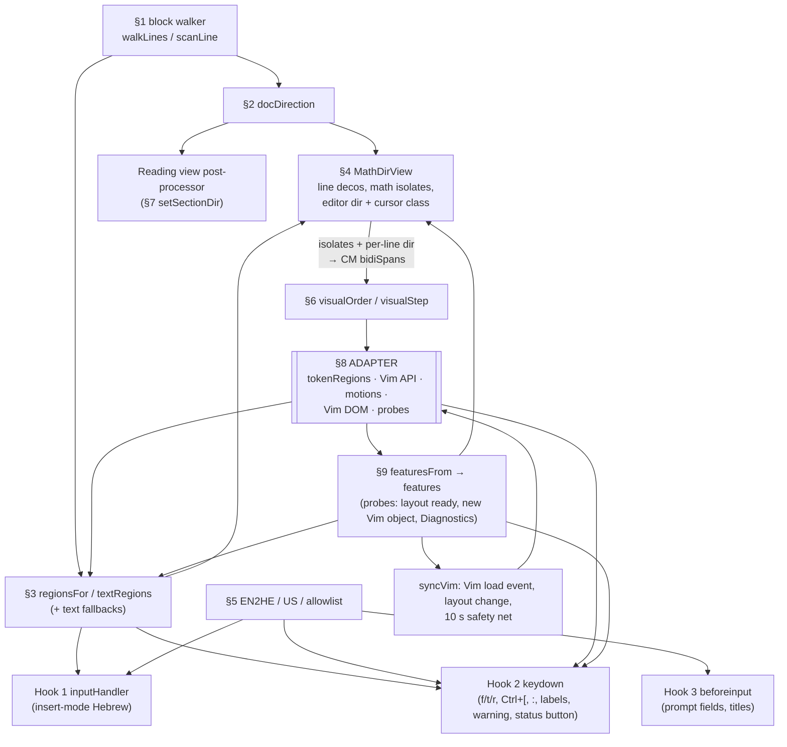

# Any Language Math (BabelFish) documentation

**Any Language Math (BabelFish)** 0.9.0, called "Hebrew Vim + Math Direction" and `math-dir` until then. Plugin id `babel-fish-math`. The plugin lives in `.obsidian/plugins/babel-fish-math/`: `src/core.js` (2161 lines), `src/vim.js` (1046 lines), `src/default-map.json`, `build.mjs`, the generated `main.js` (3250 lines), `styles.css`, `manifest.json`, `data.json`, `README.md`, and `maps/`, which the plugin creates. Edit `src/`, then run `node build.mjs`. The previous versions are backed up in `Snippets/_backups/math-dir-2.8.0/`, `math-dir-2.7.1/`, `math-dir-2.7.0/`, `math-dir-2.6.0/`, `math-dir-2.5.0/`, `math-dir-2.4.0/`, `math-dir-2.3.0/`, `math-dir-2.2.0/`, `math-dir-2.1.0/` and `math-dir-2.0.1/` (each with its `data.json`).

**0.9.0 (2026-11-09)** is internal build 3.0.0 renumbered for testing outside this vault, with no code change. Unpublished so far. Versions below 0.9.0 in this note, 1.x to 3.0.0, are the private build history and keep their numbers.

**3.0.0 (2026-11-09)** adds a configurable toggle hotkey and editable key maps (§3.9). Nothing else changes:
- **Hotkey:** the new setting `toggleHotkey`, F12 by default, changed in the plugin's settings and handled in hook 2. The command "Toggle Hebrew typing" stays, without a default hotkey of its own.
- **Key maps:** the QWERTY map is now a JSON file, `maps/qwerty.json`, written from the copy embedded in `main.js`. New maps can be added, edited, deleted and switched between in the settings. "Reset default map" restores the original.
- **`EN2HE`** is now the active map, a `Map`. `vim.js` reads it only through the core's `mappedKey` and `originalKey`. `HE_OS` stays built from the embedded original, because it describes the Windows Hebrew layout.
- **Offline tests:** `M-3.0.0-harness.js` is new. `S-3.0.0-harness.js` is a copy of `S-2.8.0` with a dropdown and two button methods in its `Setting` mock, and the new version number. V, F1, F2, F4 and the oracle run unchanged.
- **Live results for 2.8.0** on Obsidian's own Vim are recorded in §3.8.

**2.8.0 (2026-11-09)** moves the Vim integration into its own source file, behind a new setting (§2, §3.7):
- **Sources:** `src/core.js` and `src/vim.js`, joined into `main.js` by the dependency-free `build.mjs`. The community store installs only `main.js`, `manifest.json` and `styles.css`, so `vim.js` can't be a runtime file. The build fails if the core mentions a Vim internal or a name from `vim.js` other than `VimIntegration`.
- **Vim mode:** a new setting, `vimMode`, off by default and applied at once. So after updating, the Vim features stay off until you turn it on. With it on, everything behaves as in 2.7.1, except:
  - **Stock motions:** where 2.7.1 fell back to `logicalVimMotion` (Vim mode stopped, "Visual h / l" off, a failed `visualMotions` probe, plugin unloaded), the six keymap entries now reach the real `moveByCharacters`, late bound through `V.getMotion`. So `whichwrap` and Vim Motions' cell crossing come back. The visual motion's own fallback, and the V1 table-cell step, are unchanged.
  - **Diagnostics:** a new first row, "Vim Motions plugin". The notice says when only Obsidian's own Vim API is there, which 2.7.1 reported as "Vim Motions loaded" (§3.8).
  - **Obsidian's own Vim (no Vim Motions):** three guards, none of which changes anything with Vim Motions (§3.8). Replace mode with the layer on no longer loses the key, the missing `getKeymap` no longer shows a "self-check failed" notice, and the commands no longer stack each time Vim mode or the plugin is reloaded.
- **`api.visualOrder`** exists only while Vim mode is on. The visual-order code is in `vim.js`, since nothing else needs it.
- **Offline tests:** `S-2.8.0-harness.js`, plus copies of the V, F1, F2 and F4 harnesses that run with `vimMode: true`. The originals are unchanged.

**2.7.1 (2026-11-08)** applies the fixes from [[_math-dir-analysis/review|the independent review]]:
- **V1:** in a table cell, `h`/`l` no longer stick where the visual step can't move. They step logically there, as with math-dir disabled (§7). Operators and everything outside table cells are unchanged. This is the stuck case of R3.
- **V2:** R1's time window now opens only for keys that can type text (`canTypeText`, §5), so a spell-check suggestion picked with the keyboard stays as it is.
- **V3, V4:** a new limit in §10, and stale statements corrected here and in `main.js` comments. `OFF_TEXT.charArgs` now names Replace mode.
- **Offline tests:** `V-2.7.1-harness.js` in the test kit covers V1's decision and V2.

**2.7.0 (2026-11-08)** is compaction, from [[math-dir optimization report]] (C1, C2, C4, C5, C6, C8, C9, C11, C12, C13):
- The long header comment moved here and to the plugin's `README.md`.
- **Removed:** the Vim Motions version check (`vimMotionsVersion`, `checkVersion`, `TESTED_VIM_MOTIONS`), its Diagnostics row and "untested" message, the info-only `keyReaderHook` and `tokens.indent` probes, `LineScan.retarget`, `awaitingChar`, `editorWithVim`, and the unused `walkLines` parameters.
- `perf`'s timing fields stay (C7 was dropped). The probes still decide which features stay on.

**2.6.0 (2026-11-08)** adds speed-ups with no intended behaviour change (P10, P1a, P2, P6, P11):
- `h`/`l` skip measuring on lines with one bidi level.
- Live Preview tables and callouts of the active note ask its `LineScan` instead of copying the note per cell (source mode only, `sourceModeEditorView`).
- `LineScan.map` stops walking once the deciding line is known and above the edit.
- `inMathRegion` and `build` share a binary search (`firstNot`).

**2.5.0 (2026-11-08)** fixes bugs:
- **R1:** text that arrives without a real key press within 500 ms, such as a spell-check suggestion, isn't translated.
- **R2:** Replace mode (`R`, `gR`) follows the layer (`vimOverwrite`; the Hebrew key is fed to Vim).
- **R4:** `data-math-dir` on the section container now holds the note's direction, and the CSS follows it, so sections that Reading view had detached come back right. `sectionParents` (`ctx.docId` → `WeakRef`) lets a detached section reach its parent.
- **R5:** decorations rebuild on the first update after a composition.
- **R6:** the first edit of an empty note follows the rule, with no hold.
- **R7:** a line over CodeMirror's 4,096-character bidi limit that is drawn RTL counts as level 1.
- **R8:** the active view's `getViewData()` comes before its editor's text.
- **R9 + C10:** `ensureVimCommands` adds only the missing commands.
- **R10:** the `:` prompt uses `usKey`, so CapsLock no longer lowercases it.
- **R3 wasn't applied:** it was dropped on partial evidence. Vim Motions' cell-edit scope does move `h` at ch 0 and `l` at the last character out of a cell before any Vim motion runs, but the live probes pressed only those keys. In a Hebrew cell, `l` at ch 0 and `h` at the last character were stuck. 2.7.1 fixes that stuck case (V1, §7).

**2.4.0 (2026-11-05)** closes the remaining behaviour gaps from [[math-dir review report]]:
- **M6, unclosed block:** while the note ends inside a `$$` block or fence that isn't closed yet, the editor keeps the direction it had (§5 "Opening a note", §6.1). Typing `$$` or ```` ``` ```` above the Hebrew no longer flips the note.
- **M8, f/t/r character:** the character is still chosen by the cursor's context. For `f`/`F`/`t`/`T`, if it has no match on the line in the search direction (or too few for the count) and the other character does, the other one is used (§5). `r` is unchanged.
- **M9, Reading-view fallback:** for embeds, hover previews, export and Live Preview widgets, the text comes from an open editor's buffer when there is one (synchronous, unsaved edits included), else from the saved file, with a `.catch`. The sibling sweep only touches section containers (§5).
- **L10, graphemes:** `h`/`l`/`x`/`X` step over a letter with its niqqud, or a ZWJ emoji, as one character (§7).
- **L11, soft wraps:** a wrapped line is ordered row by row, as the browser draws it (§7).
- **Documented:** M5 (bracket mirroring stays, by decision), L12 (what counts as Hebrew) and L15 (secondary cursors), in §10.

Line numbers in §2 are for 2.4.0; use them as a rough guide and search by name.

**2.3.0 (2026-11-05)** makes the per-keystroke work incremental (M1, M2), with no intended behaviour change. The results are the same as a whole-note rescan. A randomized offline oracle checked this against 2.2.0 and against a from-scratch computation after every edit (§6.1).
- **Direction (M1):** a `LineScan` per doc keeps the line walk's state before every line. After an edit it rewalks only from the changed line until it's back in step with the old walk. The deciding Hebrew line is kept when the edit is below it.
- **Regions (M2):** the math/code regions are carried from the previous doc or tree. The tree is rescanned only from a safe restart point to the viewport end.
- **Background parse steps** rebuild only when the tree changed inside what was built, or the parse hadn't reached the viewport end.
- **Speed:** on a 3,000-line note an editor update takes 0.14–0.3 ms (median), down from 2.5–9 ms.
- **`p.perf` / `p.perfReset()`** count the work (§8).

**2.2.0 (2026-11-05)** is a cleanup and hardening release with no intended behaviour change, except where noted. It:
- removes the hebrew-vim coexistence code (L19);
- moves every private dependency into one **adapter** section (§2);
- adds self-checks with graceful degradation and a Diagnostics button (M7, §3.6);
- re-registers the motions on Vim Motions' load event, with a 10 s safety net (§3.2);
- fixes L1, L2, L4–L9, L13, L14, L17 and L18 from [[math-dir review report]].

Line numbers in §3 and §3.6 are for 2.2.0. Elsewhere they still refer to 2.0.1 or 2.1.0 where a section says so; use the §2 table to find code.

**2.1.0** fixed H1, H2, M3 and M4 (§5, §8, §9, §10).

Companion notes:
- [[math-dir review report]] (findings);
- [[Vim Hebrew handoff 2026-11]] (setup and known limits);
- [[Plugin audit 2026-11]] (how the other plugins behave);
- `Vim Hebrew test checklist.md` (test rounds).

Line numbers below refer to the `main.js` of the version a section names, from before the split. Search by name in `src/`. Since 2.8.0, the plugin's `this.vim` is the `VimIntegration` object, and `syncVim`, `vimVisual` and `needMap` are on that object (the Vim object itself is `V` there).

**How the facts were checked.** Statements about Vim Motions were checked against `.obsidian/plugins/vim-motions/main.js` (1.5.1). Statements about Obsidian and CodeMirror were checked against `%APPDATA%/obsidian/obsidian-1.15.0.asar`. Anything marked *(unverified)* could not be checked statically.

---

## 1. Purpose and scope

There are three features in one plugin. Since 2.8.0, everything for Vim Motions needs the Vim mode setting: feature C, and the Vim parts of A and B (the block-cursor layer, `f`/`t`/`r` and Replace mode, the Vim prompts and the fallbacks for a Hebrew OS layout).

| | Feature | Summary |
|---|---|---|
| **A** | Text direction | A note is RTL if it has a Hebrew letter (א–ת) outside frontmatter, math and code (fenced or indented, 2.2.0). A `direction: rtl\|ltr` frontmatter key overrides that. While the note ends inside an unclosed `$$` or fence, the editor keeps its direction (2.4.0, M6). Inline math is drawn as an LTR bidi isolate. Display-math, code and frontmatter lines are LTR. Reading view follows the note direction. Vim Motions' block-cursor layer follows the direction of the text under it. |
| **B** | LyX-style Hebrew typing ("the layer") | The OS keyboard stays on **English**. When the layer is on, typed letters become Hebrew (SI-1452 unshifted layout) everywhere except math and code. It also covers an allowlist of prompt fields and f/F/t/T/r character arguments; f/F/t/T fall back to the other character when the first has no match on the line (2.4.0, M8). It inserts into every selection range (visual-block insert, multiple cursors). There are fallbacks for when the OS layout *is* Hebrew: Ctrl+[ still acts as Esc (and cancels the `/` `?` `:` prompts properly), both `:` prompts still type English, normal/visual-mode keys act as their US keys, flash labels still work, and a layout warning appears. |
| **C** | Visual motions | `h`, `l`, `<Left>` and `<Right>` (normal, visual and operator-pending modes) and `x`/`X` (normal mode) step to the **visually** adjacent character, using CodeMirror's own bidi levels. Counts and operators work. Since 2.4.0 a character is a grapheme cluster (L10), and a soft-wrapped line is ordered row by row (L11). |

**Out of scope, on purpose:**
- Insert-mode caret drawing at direction boundaries (C5). Chrome draws that caret.
- Normal-mode command keys on a Hebrew OS layout. Vim Motions handles letters itself (§10.1); punctuation is a gap, see the report.
- Typing in Settings, Templater prompts and other plugins' modals. They stay English.
- Rendered math direction in Reading view or Live Preview widgets. That is in `styles.css` since 0.9.0 (before that, a separate CSS snippet).
- Other RTL scripts (Arabic and so on). See §10, L12. (Niqqud-aware motion arrived in 2.4.0, L10.)
- The `j`/`k`/`w`/`b`/`e` motions, which stay logical.
- Mobile. Since 2.2.0 the manifest says `isDesktopOnly: true` (L18): there's no status bar on mobile, F12 assumes a keyboard, and the input handler would translate a mobile English soft keyboard.
- Any setting for direction rules other than the frontmatter key.

## 2. Architecture

**The split (2.8.0).** `build.mjs` joins `src/core.js` and `src/vim.js` into `main.js`, with a "generated" line on top, and since 3.0.0 puts `src/default-map.json` in place of its `require` line in `core.js`. That line stays in the source, so `core.js` also runs on its own. They share one top-level scope, and `vim.js` uses the core's names freely. In the other direction, the core reaches Vim only through one object:

| Core → Vim (`this.vim`, or `vimLink` in module-level code; both null while Vim mode is off) | What for |
|---|---|
| `start()`, `stop()` | Vim mode on and off (§3.7) |
| `syncVim(full)`, `V` | layout ready, the settings toggles |
| `onKeyDownLabels(e)`, `onKeyDown(e)` | hook 2: before and after the layout warning. Together they keep 2.7.1's order: labels, warning, Ctrl+[, `:`, normal-mode keys, char args |
| `warnsFor(el)` | the layout warning also shows in Vim's prompts |
| `extraTextFields()`, `isExcludedField(el)` | the layer's allowlist |
| `editorClass(view, state)` | the block-cursor class on `.cm-editor` |
| `probe(overrides)`, `answers(r)`, `afterProbe(before, fromSync)`, `offText()` | `probeNow` |
| `diagnosticsRows(r)`, `loadedText(r)`, `settingsNote()` | Diagnostics and the settings tab |

**What the build enforces.** It fails, and writes nothing, in any of these cases:
- A line of a core file mentions a Vim internal, comments included: `CodeMirrorAdapter`, `.cm6`, `.cm` used as the Vim adapter (`editor.cm`, Obsidian's own handle, is allowed), `state.vim`, `cm-vim`, `vim-motions`, `getKeymap`, `defineMotion`, `getMotion`, `mapCommand`, `multiSelectHandleKey`, `handleKey`, `inputState`, `keyBuffer` or `getTableDebugState`.
- A core file's code uses a name declared at the top level of `vim.js`, other than `VimIntegration`.
- The joined file doesn't parse (a name declared in both files, say).
- `default-map.json` doesn't parse, or `core.js` has lost its `require` line (3.0.0).

`node build.mjs --check` fails if `main.js` isn't what the build produces. The output is the same on every run, also from CRLF sources.

**`src/core.js`:**

| § | Contents |
|---|---|
| header | Design comment; `require`s; constants; `features` (only `tokens`), `on(name)`, `vimLink`, `featureEpoch` |
| 1–4 | As in the table below: line walk, direction, regions, decorations (`MathDirView`, without `dirAt`) |
| 5 | Layer: the key map (`DEFAULT_MAP`, `EN2HE`, `mappedKey`, `originalKey`, `translate`, `hasMapped`), the map files (`parseMap`, `mapSlug`, `KeyMaps`), the hotkey (`hotkeyMatches`, `hotkeyRefusal`, `cleanHotkey`), modals (`useWindowOf`, `openIn`, `askConfirm`, `askName`, `openMapEditor`), then `consume`, `canTypeText`, `followsLayer`, `insertTextDirect` |
| 6 | Reading view: `SECTION_PARENTS`, `setSectionDir` |
| 7 | **Parser names**, between `BEGIN PARSER NAMES` and `END PARSER NAMES`: `isLineNode`, `tokenRegions`, `editorViews`, `activeView`, `activeEditorView`, `sourceModeEditorView`, `probeTokens`; then `tokensAnswer`, `OFF_TEXT`, `showProbe` |
| 8 | `HebrewMathSettingTab` (`displayHotkey`, `displayMaps`); the plugin class: onload, the hotkey (`setHotkey`, `recordHotkey`, `stopRecording`), Vim mode (`startVim`, `stopVim`, `applyVimMode`), `redrawEditors`, `probeNow`, `diagnostics`, hooks 2 and 3, status, Reading view |

**`src/vim.js`:**

| § | Contents |
|---|---|
| header | `VIM_CHECK_MS`, `VIM_FEATURES`, `FEATURE_ORDER` |
| V1 | Visual order and `visualStep`: old §6 |
| V2 | The old adapter's Vim parts: `vimApi`, `vimMotionsLoaded`, `feedKey`, `pendingCharArg`, the motions (`logicalVimMotion`, `stockVimMotion`, `visualVimMotion`, `inTableCell`, `VIM_COMMANDS`), the Vim DOM (`isExPrompt`, `VIM_TEXT_FIELDS`, `labelKey`, `relabel`) |
| V3 | `US`, `HE_OS`, `usKey`, `charArgFor` |
| V4 | `dirAt`, the block cursor's direction |
| V5 | `vimEditorView`, `VIM_METHODS`, `probeAll`, `featuresFrom`, `VIM_OFF_TEXT` |
| V6 | `class VimIntegration` |

The rest of this section describes the structure before the split, which still explains how the parts work together. Old §6 is now V1, old §7 is core §6, and old §8 is split between core §7 (syntax, `probeTokens`) and V2 and V5. Old §9 is now `tokensAnswer` in the core and `featuresFrom` in V5.

Before 2.8.0, `main.js` had 10 numbered sections. They split into a **public core** (§1–7, §9, §10), which uses public Obsidian and CodeMirror API (except that §5 and §7 hard-code undocumented Obsidian DOM classes, with no probes), and one **adapter** (§8), which holds every private or undocumented dependency. The core calls the adapter through a small set of functions. Only §10 holds state, plus the module-level `features` object, which the probes set.

| § | Lines (2.4.0) | Contents | Depends on |
|---|---|---|---|
| header | 1–113 | Design comment; `require`s; constants (`HEBREW`, `DIRECTION_KEY`, `WARN_EVERY_MS`=5000, `PARSE_BUDGET_MS`=8, `VIM_CHECK_MS`=10000); `features`, `on(name)`, `VIM_FEATURES`, `featureEpoch` | — |
| 1 | 114–505 | Plain-text block structure: `frontmatterEndAt`, `fenceMarker`, `closesFence`, `INDENTED`, `LIST_ITEM`, `inlineClose`, `codeSpanEnd`, `scanLine` (with an optional math `sink`), `walkLines` (kinds `fm`/`fence`/`indent`/`text`). **2.3.0:** the walker's per-line rule is `stepLine` on a packed integer state (`S_*`); `perf`; `LineScan` (the incremental walk, M1; **2.4.0** `endsOpen()`), `overrideIn`, `scanFor` | — |
| 2 | 506–530 | `docDirection(text)` (Reading view and `api`; the editor uses `LineScan.direction()`) | 1 |
| 3 | 531–796 | **Math/code regions**: `codeLines` (blank-line filling; fence state from `LineScan`), `regionsFor` (tokenizer, via the adapter's `tokenRegions`; **2.3.0** incremental: `scanRegions`, `incrementalRegions`, `treeDiffPos`, `noteEdit`), `textRegions` (text-parser fallback), `inMathRegion`, `contextAt`, `inlineDollarOpen`, `displayDollarOpen`, `inMathOrCode` | 1, adapter `tokenRegions` |
| 4 | 797–998 | Direction decorations: `LINE`, `MATH`, `MathDirView` (ViewPlugin; 2.3.0: `treeMatters`, timing; **2.4.0** `nextDir`, the M6 hold), `replacesAll`, `mathDirPlugin` + its 3 provided facets (the cursor class only while `features.cursorClass` is on) | 2, 3 |
| 5 | 999–1123 | Layer tables and DOM helpers: `EN2HE`, `translate`, `hasMapped`, `US`, `HE_OS`, `usKey`, **2.4.0** `charArgFor` (M8), `isElement`, `isTextInput`, `BLOCKED`, `TEXT_FIELDS` (Obsidian fields), `TITLE_FIELDS`, `followsLayer`, `insertTextDirect` | 3, adapter `VIM_TEXT_FIELDS`, `isExPrompt` |
| 6 | 1124–1333 | Visual order: **2.4.0** `CLUSTER_HINT`, `clusterStarts` (L10), `visualOrder`, `lineLevels`, `characters`, `reorder` (rule L2), `charEnd`, `sameRow`, `rowOrder`, `rowOrderMeasured` (L11); `visualStep` (the h/l rule, as plain data: `{ch}`, `{from,to}`, `null` or `undefined`) | CM `bidiSpans`, `lineWrapping`, `coordsAtPos`, `textDirectionAt` |
| 7 | 1334–1348 | `SECTION_PARENTS` (2.4.0), `setSectionDir` (Reading view) | — |
| **8** | **1349–1823** | **Adapter**, between `---- BEGIN ADAPTER ----` and `---- END ADAPTER ----`. See below. | Vim Motions, codemirror-vim, Obsidian internals |
| 9 | 1824–1858 | `featuresFrom(probe)` (what each feature needs), `OFF_TEXT` (notice wording) | the probe result |
| 10 | 1859–2499 | `HebrewMathSettingTab` (with Diagnostics); `HebrewMathPlugin`: onload, window attach/detach, `syncVim`, `probeNow`, `diagnostics`, `warnsFor`, `onKeyDown`, `onBeforeInput`, `insertText`, `warnLayout`, toggles, status, Reading view (`postProcess`, **2.4.0** `openText`, `applySection`) | everything |

**The adapter (§8).** Grep check: `CodeMirrorAdapter`, `.cm6`, `inputState`, `formatting-math`, `HyperMD`, `hmd-`, `vim-motions-` and `getTableDebugState` appear only between the adapter markers (0 hits outside; 34 inside in 2.2.0, 35 in 2.4.0). Its interface:

| Group | Functions / constants | Private details behind them |
|---|---|---|
| Vim API | `vimApi()`, `canFeedKeys()`, `feedKey(view, key)`, `viewForTarget(el)`, `vimCommandMode(view)`, **2.5.0** `vimOverwrite(view)`, **2.4.0** `pendingCharArg(view)` → `{cmd, count, pos}`, `vimKeyReaderActive()` | `window.CodeMirrorAdapter.Vim`, `view.cm`, `cm.state.vim.{insertMode, visualMode, sel.head, inputState.keyBuffer, inputState.prefixRepeat}`, `multiSelectHandleKey`, `cm.constructor.signal('vim-keypress')`, `getTableDebugState().fork.keyInterceptActive` |
| Motions | `defineVimMotions(V, visual)`, `mapVimCommands(V)`, `ensureVimCommands(V)`, `VIM_COMMANDS`, `VIM_LOAD_EVENT`, **2.7.1** `inTableCell(cm)` | the 5-argument motion contract, `[anchor, head]` ranges, `motionArgs.inclusive`, `head.constructor`, `cm.cm6`, keymap order and entry shape, the `vim-motions:picker-ready` event, `.cm-table-widget` around a cell's editor |
| DOM | `isVimPanelInput(el)`, `isExPrompt(el)`, `VIM_TEXT_FIELDS`, `labelsVisible(doc)`, `labelKey(e, doc)`, `relabel(e, key)` | `.cm-vim-panel` shape, Vim Motions' Ex modal, picker and input-modal classes, label classes, the label reader `kl()` reading `e.key` |
| Syntax | `tokenRegions(doc, tree, limit)` | HyperMD token names and line-wrapper nodes |
| Probes | `probeAll(view)`, `probeTokens(view)`, `activeEditorView(app)`, `editorViews(app)`, **2.6.0** `sourceModeEditorView(mdView)` | `MarkdownView.editor.cm`, `.cm-vimCursorLayer`, the Vim methods |

What stays in the core on purpose: Obsidian's own CSS classes in `TEXT_FIELDS`, `TITLE_FIELDS` and `BLOCKED` (de facto theme API, report D17), `.cm-content` (CodeMirror's), the window-capture keydown, and `execCommand`.



**One source of truth:** `regionsFor()` answers "is this math or code?". The decorations, the cursor class, the layer and f/t/r all ask it. The motions *read* the result indirectly: the isolates and line directions it produces become CodeMirror's bidi spans.

**One rule for "code" (L4, 2.2.0):** fenced **and** indented code, in both the regions and the document direction. The tokenizer decides it in the editor. The text rule in `walkLines`, used by `docDirection` and the text-parser fallback, is: a non-blank line indented by 4 spaces or a tab, outside display math, after a blank line (or the start of the body) or continuing an indented block, and not inside a list. Indented code is never scanned for math or Hebrew. M7 (indented code types English) is unchanged.

## 3. Lifecycle

### 3.1 `onload` (1314–1453), in order
1. Init fields: `lastText`, `lastDir`, `inserting`, `vim`, `vimVisual`, `needMap`, `sectionParents`, `probe`, `probePending`, `probeOverrides`, `notified`, `statusShown`, `windows`. Reset `features` to unchecked.
2. `loadSettings()`: `data.json` merged over `DEFAULT_SETTINGS`. (The hebrew-vim migration is gone, L19.) Then `keyMaps.load()` (3.0.0, §3.9).
3. `this.api = {…}`, see §8.
4. **A:** `registerEditorExtension(mathDirPlugin)`, then `registerMarkdownPostProcessor(postProcess, 100)`.
5. **B:**
   1. Status-bar **button** (`role="button"`, `tabindex="0"`), click toggle, then `updateStatus()`. Enter/Space are handled in hook 2.
   2. Command `toggle-hebrew-typing`, a plain `callback`, with no default hotkey since 3.0.0 (§3.9).
   3. **Hook 1:** `Prec.highest(EditorView.inputHandler.of(hebrewInput))`.
   4. **Hooks 2 and 3:** `attachWindow(window)`; `window-open` attaches popouts, and `window-close` detaches them (L6).
   5. Settings tab (kept as `this.settingTab`, for L14).
6. **C (2.8.0):**
   1. `layout-change` and `active-leaf-change` → the core's `onLayoutChange()`, which only runs a token check that was waiting for an editor, and only while Vim mode is off.
   2. `startVim()` if `vimMode` is on (§3.7).
   3. `onLayoutReady(() => { vim?.syncVim(); probe if not yet })`.

   `VimIntegration.start()` then adds these itself, with no `registerEvent` or `registerInterval`, so they can stop with the toggle:
   1. `workspace.on('vim-motions:picker-ready', syncVim)`: Vim Motions' load event.
   2. `layout-change` and `active-leaf-change` → its `onLayoutChange()`: a cheap `syncVim()`, plus pending editor probes once an editor with Vim exists.
   3. `window.setInterval(() => syncVim(true), 10000)`: the safety net.

### 3.2 Re-registration: the load event and the 10 s safety net (`syncVim`, 1507–1544)
Vim Motions triggers the workspace event `vim-motions:picker-ready` at the end of its `onload`, after `Yw()` installed `CodeMirrorAdapter.Vim` (checked in its `main.js`). It's unconditional and fires on every load, including after a disable/enable. There's no unload or Lua-reload event.

`syncVim(full)`:
1. `vimApi()`. If there's no Vim, clear `this.vim` and stop.
2. **A new Vim object** (`V !== this.vim`): remember it, clear the Vim-related `features` (their answers were for the old object), and `probeNow(true)` (probes first, so the steps below use fresh answers).
3. If `features.motions` is off, stop (the commands get mapped once it comes back: `needMap`).
4. If the wanted kind (visual unless the setting or the `visualMotions` probe says logical) differs from the installed one, `defineVimMotions(V, visual)`.
5. Only with `needMap` (a new object, or motions coming back) or a `full` (10 s) call while `keymapCheck` is on: check the keymap.
   - With `keymapCheck` on: `ensureVimCommands(V)` copies `getKeymap('normal')` and looks for each entry with the same `keys` **and** our `motion`. It adds only the missing ones. A user map in front doesn't cause a re-add loop, and re-enabling doesn't stack duplicates.
   - With it off (no `getKeymap`, or entries without motion names): map once per Vim object.

**Cost (L5):** a layout change or the load event does a pointer comparison, plus the keymap copy only for a new object. The keymap copy otherwise runs every 10 s, not every 2 s. `updateStatus()` writes the DOM only when the state changed.

**Latency:** after Vim Motions loads or reloads, the motions come back at once (event). If something drops our commands without a reload (a Lua `:mapclear`, an `unmap` of `h`), they come back within 10 s. Vim Motions' own Lua reload calls `resetKeymap()`, which keeps non-default entries, ours included. The settings toggle calls `syncVim()` directly.

### 3.3 Vim Motions registration facts (verified in vim-motions `main.js`)
- **Global API:** `window.CodeMirrorAdapter.Vim` is a getter (`Object.defineProperty(e.CodeMirrorAdapter,"Vim",{get(){return ei}})`). It is `delete`d when Vim Motions unloads, and a fresh object appears when it reloads.
- **`defineMotion(name, fn)`** = `function Fa(d,h){Tt[d]=h}`. `evalInput` calls `Tt[b].call(Tt, cm, head, motionArgs, vim, inputState)`.
  - An array result is `[anchor, head]`.
  - A falsy result returns early: no move, no operator.
  - A Promise result is supported too (unused here).
- **`motionArgs`** is a fresh shallow copy per command: `processMotion` does `inputState.motionArgs = xg(command.motionArgs)`. So mutating it, as with `inclusive = false`, is safe.
- **Operator ranges** are exclusive unless `motionArgs.inclusive` is set (`var Oe=!E.inclusive||he`).
- **`foldopen`** is a fork-only motionArg. It sets `cm._pendingFoldopen` on a plain move. The stock `h`/`l` defaults carry `foldopen:"hor"`, and so do ours.
- **`mapCommand(keys,type,name,args,extra)`** = `k9`. It builds `{keys,type,[type]:name,[type+"Args"]:args,...extra}` and calls `Mg`, which **`unshift`s** the command into the keymap.
- **Matching:** the matcher `XT` takes `full[0]`, the first match, so our entries win over the defaults, which stay in place.
  - A command with no `context` matches in normal, visual, select and operator-pending modes.
  - Insert mode only matches `context:"insert"` commands, so insert-mode arrows stay native.
- **`<Left>`/`<Right>`** are default `keyToKey` → `h`/`l`. Those keys are fed through `Be()` with `Et = noremap != false`, i.e. noremap. In noremap mode, `XT` starts searching at `h.length - l`, which covers the built-in defaults only. So without our own `<Left>`/`<Right>` entries, the arrows would hit stock `h`/`l`.
- **`removeMapCommand(keys)`** removes *every* non-`keyToKey` entry with those keys, defaults included. That's why the plugin never calls it.
- **`getKeymap(ctx)`** returns copies that include `keys`, `type`, `context` and `motion`. That's what `ensureVimCommands` relies on (2.2.0: probed as "keymap entries carry motion names").


### 3.4 `onunload` (1455–1466)
- `stopRecording()`, if a hotkey recording is running (3.0.0).
- `stopVim()`, if Vim mode is on (§3.7). If the live Vim object is the one we registered on (and `defineMotion` exists), it runs `defineVimMotions(V, false)`. Both motion names become really stock: `stockVimMotion` calls `V.getMotion('moveByCharacters')` on each key (2.8.0). The 6 keymap entries **stay** (they can't be removed safely).
- It detaches the keydown/beforeinput listeners from the main window and every popout still open.
- Everything else is cleaned up by Obsidian's `Component` machinery: editor extensions, the status button's click, the core's events, the status bar item, the command and the settings tab.
- Not cleaned up: Reading-view `dir`/class/`data-math-dir` attributes on already-rendered sections (until they re-render).

### 3.5 Coexistence with the old hebrew-vim plugin: removed in 2.2.0
2.2.0 deleted `OLD_PLUGIN_ID`, `oldPlugin()`/`oldPluginActive()`, the `old.register` hook, `copyOldState`, the `data.json` migration, the settings warning, the disabled toggle, the command's `checkCallback` and the status-hiding branch (L19). hebrew-vim was deleted on 2026-11-05.

**If hebrew-vim is ever restored** (its backup is `Snippets/_backups/hebrew-vim-3.0.0/`): disable math-dir first, or restore math-dir 2.1.0 from `Snippets/_backups/math-dir-2.1.0/`. With both on, text would be translated twice.

### 3.6 Probes and graceful degradation (M7)
`probeNow()` (1559–1599) runs at layout ready, for each new Vim object, when an editor with Vim first appears (if the editor probes were pending), and from Diagnostics. The probes are in the adapter (`probeAll`, `probeTokens`), and `featuresFrom` (§9) turns them into features:

| Probe | How | Feature if it fails | Degraded behaviour |
|---|---|---|---|
| Vim methods `handleKey`, `defineMotion`, `mapCommand`, `getKeymap` (and `multiSelectHandleKey`) | `typeof V[m] === 'function'` | `defineMotion`/`mapCommand` → `motions`; no `handleKey` **and** no `multiSelectHandleKey` → `charArgs`, `escape`; `getKeymap` → `keymapCheck` | No motions (Vim Motions' own h/l). f/t/r and Replace mode get the English letter. Ctrl+[ in the note passes through (CodeMirror's indent-less runs). Commands mapped once per Vim object. |
| Keymap entry shape | `getKeymap('normal')` has `{keys:'j', motion:'moveByLines'}` | `keymapCheck` | as above |
| Key buffer | `view.cm.state.vim.inputState.keyBuffer` is an array or string | `charArgs`, `usKeys` | f/t/r and Replace mode get the English letter; with the OS on Hebrew, normal-mode keys aren't relabelled (Vim Motions' own `e.code` mapping still covers letters) |
| Back-pointer | `view.cm.cm6 === view` | `visualMotions` | Logical h/l/x/X (§7) |
| Cursor layer | `view.scrollDOM` has `.cm-vimCursorLayer` | `cursorClass` | No `math-dir-cur-*` class (there's nothing to style anyway) |
| Tokenizer self-test | Parse `a $x$ b … $$ … ``` … ` + indented line with the editor's own `language` (`Language.extension`) in a throwaway `EditorState`, `ensureSyntaxTree`, then `tokenRegions` must find `$x$`, the `$$` block and the fence line | `tokens` | Regions from the **text parser** (`textRegions`): same rules as `docDirection`; loses math in HTML/`%%`, `> $$` in callouts, and indented code inside lists; O(note) per edit |

Rules:
- An editor probe that can't run (no editor open, or Vim not on it) is `null`, which keeps the last conclusive answer (unchecked counts as on). A new Vim object clears the Vim-related answers.
- The token probe's result is cached per `Language`. "Unknown" (no language, or the throwaway parse produced no tokens) keeps the tokenizer, as in 2.1.0. Only "parsed, but the names don't match" switches to the text parser.
- **Notice:** one `Notice` (15 s) when a feature newly turns off, naming everything that's off, plus one `console.warn` with the probe object. A feature already reported doesn't bring it back.
- When `tokens` or `cursorClass` flips, `featureEpoch` is bumped and every editor gets an empty `dispatch`, so the decorations and attributes rebuild.
- **Testing hook (Console only):** `p.probeOverrides = { backPointer: false }` (or `{ tokens: { ok: false } }`, `{ keyBuffer: false }`, `{ methods: { handleKey: false } }`), then `p.diagnostics()`. Clear it with `p.probeOverrides = {}` and run `p.diagnostics()` again.

**Diagnostics** (Settings → Diagnostics, or `app.plugins.plugins['math-dir'].diagnostics()`): runs the probes, prints a `console.table` (check / result / feature: `pass`, `FAIL`, `n/a`, then each feature `on`, `on (unchecked)` or `OFF`), shows a 10 s Notice ("Vim Motions loaded. All features on. Table in the Console."), and returns the rows. With Vim mode off it has only the token check ("editor open", the tokenizer row, `feature tokens`), and the Notice says "Vim mode off".

### 3.7 Vim mode: the toggle (2.8.0)

`settings.vimMode`, default `false`. The settings toggle saves it, calls `applyVimMode()` and redraws the tab, so "Visual h / l" shows only while it's on. The description says it works best with Vim Motions, and that Obsidian's own Vim mode gets everything except jump labels (§3.8). If Vim mode is on and Vim Motions isn't loaded, the description says that too, and so do the Diagnostics row and notice, with no errors.

**Off (`VimIntegration.stop()`):**
1. Binds the two motion names to `stockVimMotion` if the live Vim object is ours.
2. `workspace.offref` on its 3 events and `clearInterval` on the safety net.
3. Deletes `api.visualOrder`, and removes the Vim keys from `features` and `notified`.

`applyVimMode` then sets `plugin.vim` and `vimLink` to null, runs the token check, and redraws the editors, which drops the `math-dir-cur-*` class. From then on nothing reads `window.CodeMirrorAdapter`, and the listeners that stay (keydown, beforeinput, layout events) take only the core's paths.

**The six entries stay.** `removeMapCommand` would also remove Vim's own `h` and `l`.
- **`getMotion`:** it's an exported API in the fork, `getMotion:function(d){var h=Tt[d];return h&&h.bind(Tt)}`. It's read on each key, because Vim Motions swaps `moveByCharacters` for its cell-crossing version while a table scope is up, and restores it afterwards (`defineMotion("moveByCharacters",$le(e))`).
- **No recursion:** the plugin never defines `moveByCharacters`, and it only ever calls the saved stock motion.
- **Missing `getMotion`:** falls back to `logicalVimMotion`.
- **`x` and `X`:** they stay delete operators. Their entries carry `operator: 'delete'` and `motionArgs.forward`, the same shape as the defaults.
- **Same binding:** "Visual h / l" off, a failed `visualMotions` probe, and unload.
- **Unchanged:** `visualVimMotion` still falls back to `logicalVimMotion`, including the V1 table-cell step, so `h` and `l` with "Visual h / l" on stay as in 2.7.1.

**On:** `applyVimMode` creates the object and calls `start()`, then `syncVim()`, which treats the Vim object as new: probes, the motions, and `ensureVimCommands`, which adds only what's missing, so nothing stacks. If there's no Vim object yet, it registers when one arrives, through the load event, a layout change or the safety net.

**With Vim Motions on and Vim mode off,** Vim Motions works by itself:
- `h`/`l`/`x`/`X` are stock, and `f`/`t`/`r` take the English key.
- Its `:` modal outside the editor is a plain `input.prompt-input`, so it follows the layer like any other prompt: turn the layer off to type there. (`isExPrompt` is Vim code, so the core can't tell it apart.)
- The `/` and `?` prompts stay out of the layer.

### 3.8 Obsidian's built-in Vim (checked in `obsidian-1.15.0.asar`)

**What's exposed.** `app.js` runs `jn=initVimMode(Io);Io.Vim=jn;window.CodeMirrorAdapter=Io` at startup, whether or not Obsidian's Vim setting is on. So `window.CodeMirrorAdapter.Vim` is always there, as a plain property rather than a getter. Vim Motions installs its getter over that property on the same object, and `delete`s it on unload, so after that the property is gone until Obsidian restarts.

`view.cm` is set by the built-in Vim view plugin (`this.view.cm=this.cm`), which is only in the editor while Obsidian's Vim setting is on. It's removed with the plugin (`delete this.view.cm`). `cm.cm6` is set too.

That's why `vimApi()` can't answer "is Vim Motions loaded?". `vimMotionsLoaded()` looks for `CodeMirrorAdapter.setKeyInterceptActive`, which Vim Motions adds with its getter and deletes on unload.

**Live results, on 2.8.0 with Vim Motions off and Obsidian's Vim on:**
- **Passed:** visual `h`, `l` and `<Left>`; `x`; `dl`; the edge stop; typing; math; multiple cursors; `f`, `r` and the fallback; `R` in text and in math; the `/` and `:` prompts; Ctrl+[ and `.` on the Hebrew layout; the cursor class; toggling; Diagnostics, where only `getKeymap` is missing and `keymapCheck` is off.
- **Didn't pass:**
  - `R` then Backspace doesn't restore the old letter. That's Obsidian's behaviour: English with math-dir disabled does the same.
  - In Hebrew the cursor moved to ch 3 where English went to ch 1. This wasn't compared with math-dir disabled, so the cause is open.
- **Not run:** `gR` and flash labels. For those, the table below is all there is.

**Feature by feature, with Obsidian's Vim setting on and no Vim Motions.** The table is what the source says (`app.js`, `lib/codemirror/vim.js`) and what the offline mocks show. The list above is what was run.

| Feature | Result | From source |
|---|---|---|
| Visual `h`/`l`/`<Left>`/`<Right>` | Works | `defineMotion`, `mapCommand` (same `unshift`), the 5-argument call, `motionArgs` copied, `head` from `new Pos`, `cm.cm6`. The noremap rule for the arrows is there too, and our entries cover it. `app.js` tries `tryHandleKey` first, so `h`/`l` next to a Live Preview image still enter or leave it |
| `x`/`X` | Work | Same entries as the fork's: array results, `motionArgs.inclusive` |
| Stock motions (Vim mode off, "Visual h / l" off) | Logical | No `getMotion`, so `logicalVimMotion`. This loses `whichwrap`, and the built-in has no cell crossing to lose |
| Keymap check | Off, by design | No `getKeymap`. `keymapCheck` is off in Diagnostics, with no notice (a guard). Commands are mapped once per Vim object, marked on the object (a guard), because it outlives toggling and plugin reloads |
| `f`/`t`/`r` | Work | `multiSelectHandleKey`, `keyBuffer` (an array), `prefixRepeat`, `vim.sel.head`, `cm.constructor.signal` |
| Replace mode (`R`) | Works, with a guard | `handleKey` returns false in Replace mode, and `app.js`'s own handler then calls `overWriteSelection(e.key)`. Our branch consumes the key, so that handler never runs. **Without the guard the letter was lost.** `feedKey` now reports "not handled", and we call `cm.overWriteSelection` ourselves. In the fork, `handleKey` overwrites and returns true, so nothing is written twice |
| `gR` | Not there | The built-in Vim has no virtual-replace mapping |
| Ctrl+[ | Works | In the note, `feedKey('<Esc>')`. In a prompt, `relabel` to `[`, and `onPromptKeyDown` cancels on `<C-[>`. One gap: Ctrl+[ doesn't clear a search highlight in normal mode, because `app.js` does that in its handler before Vim |
| `/` `?` `:` prompts | Work | `.cm-vim-panel` (`AIe` in `app.js`) with the same `makePrompt` shape, `div > span(prefix, input)`. So `/` and `?` follow the layer and `:` stays English |
| Normal-mode keys on a Hebrew OS | Work | `vimKeyFromEvent` reads `e.key`, so `relabel` takes effect |
| Cursor class | Works | `n3` makes `cm-cursorLayer cm-vimCursorLayer` in `scrollDOM`, and draws the letter under the cursor |
| Jump labels | Don't exist | `labelKey` finds nothing: one selector query, only for a non-Latin key |
| `getTableDebugState` | Missing | `vimKeyReaderActive` counts it as "no reader" |
| Vim Motions' modals | Don't exist | `isExPrompt` and `VIM_TEXT_FIELDS` never match them |
| The load event and the 10 s net | Idle | `vim-motions:picker-ready` never fires. `syncVim(true)` is only a pointer comparison, since `keymapCheck` is off and there's one Vim object. So after a `:mapclear` nothing re-adds our commands. If Vim Motions loads later, its event still works |

**With Obsidian's Vim setting off and no Vim Motions:** `V` exists, so the motions and commands are registered on it, which has no effect. `view.cm` is absent, so `viewForTarget` returns null and every Vim key path passes the key along. The `math-dir-cur-*` class is added with nothing to style.

**What could throw:** nothing found. Every Vim Motions-only reach has a `typeof` or null check, or a `try`.

**`S-2.8.0-harness.js`** covers all of this with a mock of that API. It doesn't run Obsidian's real Vim.

### 3.9 The toggle hotkey and key maps (3.0.0)

**The hotkey.** Obsidian has no public API for a plugin to change its hotkeys, so the plugin handles the key itself.
- **Setting:** `toggleHotkey` is `{ code, ctrl, alt, shift, meta }`, or `null` for none. A `data.json` from before 3.0.0 gets F12. A value it can't read gets F12 too.
- **Matching:** first in hook 2, on `e.code` and all four modifiers, so it doesn't depend on the keyboard layout. A match is consumed. Holding the key toggles once, which is new. Untrusted events and composition are ignored, like everything else in hook 2.
- **The command** keeps working from the palette and from Obsidian's Hotkeys. It has no `hotkeys` field. Obsidian's keymap listens at window capture too, and its listener was added first, so with both the key would toggle twice. For the same reason, don't give the command the same key in Obsidian's Hotkeys.
- **Settings:** the current hotkey, then **Change**, **Clear** (no plugin hotkey; the command stays) and **Reset to F12**.

**Recording** (`recordHotkey`). It listens in the window the settings are in (`containerEl.ownerDocument.defaultView`), for `keydown` and `keyup` at capture, and `blur`.
- **Cancels on:** Esc, the window losing focus, the settings tab closing, a second Change, unload.
- **Refused, with a notice, and recording goes on:**
  - a key without Ctrl, Alt or Meta, unless it's a function key, `Insert`, `Pause` or `ScrollLock`. Shift doesn't count, so Shift+a is refused and Shift+F5 is fine. Enter, Tab, the arrows and so on are refused like letters, because they edit.
  - a key with no `code`.
  - a modifier on its own. That notice waits until the modifier is released, because Ctrl goes down first on the way to Ctrl+J.
- **Nothing else sees the keys.** `onKeyDown` returns at once while `this.recording` is set, and the recorder consumes the keys. That isn't enough in a popout. Every popout window has a capture listener from Obsidian (`PV` in `app.js`) that relays `keydown` to the main window's keymap, and it was added before any plugin's, so the keymap runs first. Settings' own scope would take Esc and close Settings. So recording also pushes a catch-all `Scope` (`register(null, null, () => false)`) with the public `app.keymap.pushScope`.

**Which window.** Attached windows are the main one and the popouts `window-open` reports. The Settings window isn't one of those: Obsidian opens it without that event. So while the focus is in the Settings window, the plugin's hotkey does nothing there; its relayed copy reaches the main window untrusted, and hook 2 ignores it. The toggle in that tab still works. With Settings in the main window, the hotkey works there too.

**The files.** `<manifest.dir>/maps/*.json`, through public `app.vault.adapter` calls.
```json
{ "name": "QWERTY → Hebrew (SI-1452)", "keys": { "q": "/", "w": "'" } }
```
- **The original** is `src/default-map.json`, inlined into `main.js` by the build, because the store installs only `main.js`, `manifest.json` and `styles.css`. So the embedded copy is the source of truth.
- **On load:** creates the folder, writes `qwerty.json` if it's missing, and reads every `*.json`. The id of a map is its file name without `.json`. The setting `activeMap` holds it, default `qwerty`.
- **A valid file:** an object with `name` (a non-empty string) and `keys` (an object), each key and value exactly one code point. So `__proto__` and `constructor` are refused as keys, and the lookup is a `Map`, so they couldn't misfire anyway. A map with no keys is valid. A leading BOM is dropped, because Notepad adds one.
- **An invalid file** is skipped and never overwritten. One notice names every skipped file and why.
- **An active map that's invalid or missing:** the embedded original is used in memory, with a notice. `activeMap` is kept, so the map comes back after a fix and Reload.
- **What the map feeds:** `translate`, `hasMapped`, `hebrewInput`, the field layer (hook 3), `charArgFor` and Replace mode. Switching applies at once.
- **What it doesn't:**
  - `HE_OS` stays built from the embedded original, because it describes what Windows' Hebrew layout sends, not the user's map.
  - `isHebrewLetter` and the direction rules don't change. A map to another script is the user's business: that text doesn't make a note RTL.

**Settings:**
- **Key map:** a dropdown of the valid maps. If the original is in use because the active map isn't available, it says so as an extra entry.
- **New:** asks for a name and copies the active map to `maps/<slug>.json`. The copy becomes the active map, so Edit then works on it. The slug is `[a-z0-9-]` only, at most 40 characters, so it can't leave `maps/`. A Hebrew name has no such characters and gets `map`, then `map-2`. Names Windows reserves get a `map-` prefix. The folder is listed again first, so nothing is overwritten.
- **Edit:** the active map's file in a monospace, LTR textarea, which the layer doesn't reach: it isn't on the `followsLayer` allowlist. Save validates and, when refusing, shows the reason in the modal and leaves the file unchanged. A valid edit is saved exactly as typed. It also opens an invalid active file, so it can be fixed, and it works on the default map.
- **Delete:** for non-default maps, after confirming. It removes the file for good. If the map is active, the default becomes active.
- **Reload:** reads the folder again, for edits made outside Obsidian.
- **Reset default map:** rewrites `qwerty.json` from the embedded original, after confirming, because that discards edits.

**Modals when Settings has its own window** (`settingsPopoutWindow`, on by default). `Modal.open()` appends to `activeWindow.document.body` (`app.js`), and `keymap.pushScope` goes by `activeWindow` too. Obsidian keeps that global on the window that last had focus, so it's normally right. `useWindowOf(el)` makes sure of it: if the global isn't the window `el` is in, it sets `activeWindow` and `activeDocument` there, as Obsidian does itself when Settings opens. Writing that global isn't documented API. If a future Obsidian changes this, a modal would show up in the other window.

## 4. Hooks

| # | Hook | Layer | Where | Why this layer |
|---|---|---|---|---|
| 1 | `EditorView.inputHandler` | `Prec.highest`, per editor | 915–938 | Sees text arriving in the editor: typing, an IME commit, and also a spell-check replacement, which is why R1's time window exists (§5). It never sees Vim normal/visual commands. Those are consumed at keydown and never insert text. So normal mode needs no special case. |
| 2 | `keydown` | **window**, capture | 948–956, 1078–1156 | Must run before Vim Motions. Vim Motions reads keys via CM **`eventObservers`** (`{eventObservers:{keydown:…this.handleKey(e,t)}}`). These run before any `domEventHandlers` and can't be cancelled by them. Vim Motions' own capture listeners are on `document` or lower, and its 3 window-capture listeners never call `stopImmediatePropagation` ([[Plugin audit 2026-11]] §3a). Window capture is the earliest point for us, and `stopImmediatePropagation` there hides the key from everything later. |
| 3 | `beforeinput` | **document**, capture | 952, 1159–1168 | Text fields outside the note. `beforeinput` carries the inserted text (`e.data`) and is cancellable. Capture beats field-level listeners. Not used for the note (`.cm-content` is in `BLOCKED`), because hook 1 owns it. |
| 4 | Decorations | `EditorView.outerDecorations` | 499–508 | Line decorations (`dir` + class) and math marks. `outerDecorations` wrap every other span (HyperMD tokens, LaTeX Suite conceal and bracket colours), so a formula isn't split into pieces. Line attributes from here are meant to override Obsidian's own per-line `dir` decoration (below). |
| 5 | Bidi isolates | `EditorView.bidiIsolatedRanges` | 502 | Makes CM's bidi algorithm, and so cursor motion and `bidiSpans`, treat each inline formula as one LTR isolate. This is how `@codemirror/language`'s `bidiIsolates()` does it. |
| 6 | Editor attributes | `EditorView.editorAttributes` | 503–506 | `dir` + `math-dir-rtl\|ltr` + `math-dir-cur-ltr\|rtl` on `.cm-editor`. That's the base direction for CM's measurement and the hook for the CSS. |
| 7 | Reading view | `registerMarkdownPostProcessor(…, 100)` | 888, 1227–1257 | Runs after Obsidian's core post-processor, which sets `dir="auto"` on `h1–h6, blockquote, .callout-title`, and on `li, p` when the parent has no `dir` (verified in app.js). Sets `dir` + class on each section `el`; the CSS then forces every block inside. |
| — | Vim Motions load event + 10 s safety net | `workspace.on('vim-motions:picker-ready')`, `registerInterval` | 2.2.0: 1431–1438 | The load event re-registers at once; the interval re-adds commands something dropped, see §3.2. |
| — | Popout attach/detach | `window-open` / `window-close` | 2.2.0: 1468–1486 | L6: a popout's listeners are released when it closes. |
| — | Status bar click, command, settings tab | standard API | 891–907, 827–866 | — |

**Obsidian facts behind hook 4** (verified in app.js 1.15):
- Obsidian always installs `Dae()` = a ViewPlugin `G4e` plus **`EditorView.perLineTextDirection.of(true)`**.
- `G4e` adds `Decoration.line({attributes:{dir}})` per visible line, after the frontmatter. `dir` comes from the line's first strong character (`TH`); a line with no strong character inherits the previous line's value (`"auto"` at the start).
- Because `perLineTextDirection` is on, CM's `bidiSpans(line)` uses each line's **computed** direction. So the plugin's line `dir` really does change the bidi levels the motions read.
- The CSS classes `math-dir-line-rtl|ltr` (`styles.css` 7–13) back up the attribute, whatever the attribute-merge order.

## 5. Data flow for the key scenarios

**Typing a Hebrew letter in insert mode** (layer on, OS on English, key `a`):
1. Hook 2 sees `keydown a` and records the time (`lastKeyAt`). It's not a label or Ctrl+[, and `pendingCharArg` is null in insert mode, so it returns.
2. Vim Motions' observer gets `a`. In insert mode Vim passes it through.
3. The browser inserts `a` and CM calls the input handlers. `hebrewInput`:
   - checks `settings.hebrew`, `!view.composing`, `hasMapped`;
   - checks that a key that can type text came within the last 500 ms (`TYPED_WITHIN_MS`; 2.5.0, R1). Text with no such key, like a spell-check suggestion, stays as it is. `canTypeText` (2.7.1, V2) decides what hook 2 records: a one-character key, `Unidentified`, `Dead` or `Process`, without Meta and without Ctrl alone. Alt may type text (AltGr can read as Ctrl+Alt, and there's Alt+numpad). A popout that was open at load has no hook 2, so it skips this check;
   - checks `!inMathOrCode(state, from)`;
   - translates to `ש`;
   - then offers `ש` to every *other* handler in the facet. For example, closeBrackets pairs the mirrored `)` → `(` case.
   - If none takes it, it dispatches its own `defaultInsert()`. The same transaction factory is passed to the other handlers as their 5th argument.
   - **2.1.0 (H1):** `defaultInsert` mirrors CodeMirror's `applyDefaultInsert`. When the change is at the main selection, `state.changeByRange` inserts into **every** range, with userEvent `input.type` and scrollIntoView. Each range gets the Hebrew text, except a range inside math or code, which gets the original key. With one cursor this is the old `{changes:{from,to,insert:'ש'}, selection: from+1}`. A change away from the main selection (rare) still makes one cursor. The factory is memoised, like CM's.
   - closeBrackets doesn't call `defaultInsert`: it pairs on every range itself. So `)` → `(` auto-pairs at each cursor, as with the OS layout.
   - Translation is decided at the **main** range. If the main cursor is in math, the handler declines, and every range gets the English key from CM.
4. `MathDirView.update`: `docChanged` → `noteEdit` carries the doc's `LineScan` and regions over the edit, and `LineScan.direction()` decides the direction (2.3.0, M1; see §6.1). Then the decorations are rebuilt, with the regions rescanned only from the edit on.

**Normal-mode command with Windows on Hebrew** (2.1.0, H2; key `.` → `e.key='ץ'`, `e.code='Period'`):
1. Hook 2: `labelKey` returns null (no labels). `warnLayout()` runs for a Hebrew letter. Then the relabel (main.js 1243–1257) applies when all of these hold:
   - `usKey(e)` gives a US key: no Ctrl/Alt/Meta/Shift, and `e.key` is **exactly** what the Windows Hebrew layout types on that physical key. That's `HE_OS[code]`, built from the embedded original map (`originalKey(US[code])`, never the active map, 3.0.0), plus `` ` `` → `;`. So other layouts are never touched.
   - The target is the note (`viewForTarget`), Vim Motions is present, and `features.usKeys` is on (2.2.0).
   - Vim is not in insert or replace mode (`vimCommandMode`).
   - Vim isn't waiting for an f/F/t/T/r character (`pendingCharArg`).
   - No jump labels are visible.
   - No Vim Motions key reader is active (`vimKeyReaderActive`, see below).
2. If so, `relabel(e, '.')` shadows `e.key` on the trusted event (the label technique), and `warnLayout()` runs (same 5 s throttle). Nothing is stopped: Vim Motions' `vimKeyFromEvent` reads `.`.
3. Without the relabel, `vimKeyFromEvent` (`function $(d,h)`) maps a key with char code >128 to `e.code.slice(-1)`, except for a literal-next. That's right for `KeyJ` → `j`, but `.` → `d`, `,` → `a`, `;` → `n`. And ASCII keys pass unchanged: `/` sends `.`, `q` sends `/`, `w` sends `'`, `'` sends `,`, `` ` `` sends `;`, and `[`/`]` are swapped. Letters are relabelled too, which gives the same result as Vim Motions' own mapping.
- **Shifted keys aren't relabelled.** What the Hebrew layout gives with Shift isn't in the table: Shift+letter is a Latin capital, but `<` `>` `{` `}` `(` `)` may be mirrored. Check live.
- **Literal-next arguments other than f/t/r** (marks `m` `'` `` ` ``, registers `"`, macros `q` `@`, surround characters) now get the US key. In 2.0.1 they got the Hebrew character. Vim marks and registers are Latin, so this is intended.
- **`vimKeyReaderActive()`** reads `window.CodeMirrorAdapter.getTableDebugState().fork.keyInterceptActive`. That's Vim Motions' `Ps()` flag, set (`ln(true)`) while flash search, easymotion or hint mode collects keys through `kl()`. Those keys pass unchanged, so a flash-search pattern can still be Hebrew with the OS layout. If the hook is missing or throws, it counts as "not active".

**f/F/t/T/r** (layer on, OS on English, `fa` on a Hebrew line):
1. `f`: Vim's keyBuffer becomes `"f"` (a partial match on `f<character>`).
2. `a`: hook 2 checks:
   - `settings.hebrew && mappedKey('a')` (the active map, 3.0.0);
   - `features.charArgs` is on (2.2.0);
   - `viewForTarget(target)` (target inside `.cm-content`, view has `.cm`);
   - `canFeedKeys()` (2.2.0: `multiSelectHandleKey` or `handleKey` exists);
   - `pendingCharArg(view)` (2.4.0; adapter) returns `{cmd, count, pos}`: the keyBuffer joined matches `/^(\d*)([fFtTr])$/` in a non-insert mode. `count` = those digits × `inputState.prefixRepeat` (a count typed before an operator, `2d3fa` → 6), as in the fork's `getRepeat()`. `pos` = the cursor, or in visual mode `vim.sel.head`.
3. `charArgFor(state, arg, 'a')` (2.4.0, M8) picks the character:
   - **First choice, by the context at `pos`** (as before): `ש` in text, `a` itself in math or code (`inMathOrCode`).
   - **For `f`/`F`/`t`/`T`:** count the first choice's matches on the cursor's line in the search direction: after the cursor for `f`/`t`, before it for `F`/`T`. For `t`/`T` the character right beside the cursor doesn't count (it wouldn't move). If there are fewer than `count` and the other character (`a` from text, `ש` from math) has enough, take the other one. If neither has enough, keep the first choice.
   - **`r`:** always the first choice. Replace has nothing to match.
4. If the answer is the key itself (`a`), hook 2 returns and the event goes on: Vim reads `a` as typed. Otherwise `preventDefault` + `stopImmediatePropagation` and `feedKey(view, 'ש')`. That's `multiSelectHandleKey(cm,'ש','user')`, plus `cm.constructor.signal(cm,'vim-keypress','ש')`, which the which-key popup and yank ring listen to.
5. With the OS on Hebrew, the key is already `ש`. It isn't in the default map, so it passes through, and Vim treats it as a literal because `expectLiteralNext` is set. **No M8 fallback in that case** (§10).
- An operator in front (`df`, `ct`) works: the keyBuffer is cleared after the operator matches, then holds `f`.
- **`;` and `,`** repeat the character Vim actually got (it records `lastCharacterSearch.selectedCharacter` from the key it was fed or read), so after a fallback they repeat the fallback character.
- **Flash** (Vim Motions' `f`/`t` with labels) gets the chosen character, so its matches and labels are for that character. The choice is made first, from the current line only.

Examples (layer on): from Hebrew text, `fx` to an `x` in `$…$` on the line, with no `ס` ahead → `x`. From inside `$…$`, `fa` with no `a` ahead but a `ש` → `ש`. `dfx` and `2fx` follow the same rule (with the count).

**Flash labels** (OS on Hebrew; Vim Motions shows `.vim-motions-easymotion-label`/`.vim-motions-hint-label`):
- All label readers go through Vim Motions' `kl()`. It adds a `keydown` listener on `activeDocument` (capture) that reads `e.key`, with no `isTrusted` or `e.code` check.
- Hook 2 runs earlier (window capture). `labelKey` requires:
  - no modifiers, and `US[e.code]` exists;
  - `e.key !== US[e.code]` and `e.key` is a single character;
  - some visible label contains that Latin letter.
- If so: `Object.defineProperty(e,'key',{value:en})` shadows the prototype getter on the *same trusted event*. Nothing is re-dispatched. It then `return`s, so there's no warning or other handling.
- With the OS on English, labels need nothing: `e.key` is already Latin. With the layer on, the label key reaches `kl` untouched, because `pendingCharArg` is null by then (Flash waits asynchronously, outside the keyBuffer).

**Ctrl+[ with Windows on Hebrew** (2.1.0, M4; physical `[` → `e.key=']'`, `e.code='BracketLeft'`):
- **In a `/` `?` `:` prompt** (`.cm-vim-panel input`): `relabel(e, '[')`, and the event goes on. The prompt's own keydown handler reads `$(e)` = `<C-[>` from `e.key` with `ctrlKey`, which is its cancel path. In Vim Motions that's `W` for search and `E` for `:`. Cancel means:
  - restore the previous search query, and scroll back to where the view was before incsearch;
  - `clearInputState` (`le(d)`), which clears a pending `d/`;
  - push the history;
  - `e_stop`, and refocus the note.
- If the relabel fails, it falls back to the old `blur()`, which closes the prompt through `closeOnBlur` with none of that cleanup.
- **In the note:** unchanged. `feedKey(view, '<Esc>')`, with the event stopped (2.2.0: only while `features.escape` is on and `canFeedKeys()`; otherwise the key passes through).

**Vim Motions' Ex modal** (2.1.0, M3; `:` outside the editor, a `SuggestModal` `jq`):
- `isExPrompt(el)` also matches an `input` with `placeholder === 'Ex command'` inside `.vim-motions-prompt-modal-container`. Two things follow:
  - `followsLayer` excludes it, so the layer never types Hebrew there;
  - with the OS on Hebrew, hook 2's `:` fallback inserts the US key (`insertText`, which fires `input`, so the suggestions update).
- Why not `BLOCKED`: the same container class is on the picker (`Ea`), outline, actions and search-results modals, which are meant to follow the layer.

**`dl` in an RTL line** (`שלום`, cursor on `ו`):
1. `d` → operator. `l` matches our entry first → motion `mathDirVisualRight` → `visualMotion(false)`.
2. `visualOrder(view, line)`: per-char levels from `view.bidiSpans(line)`, then the L2 reversal.
   - Visual order, left to right: `ם ו ל ש` → indices `[3,2,1,0]`. The head index 2 is at position `p=1`.
3. With an operator: `picked = seq.slice(p, p+n)` = `[2]`, so `from=2`, `last=2`. It sets `motionArgs.inclusive=false` and returns `[Pos(2), Pos(charEnd=3)]`.
4. `applyOperator` deletes `[2,3)` = `ו`. The cursor stays at index 2, which is now `ם`, visually left.
- `x` is the same command shape: `operatorMotion` delete + `mathDirVisualRight`, normal mode only.

**Arrow keys**
- Normal, visual and operator-pending: `<Left>`/`<Right>` match our own entries (§3.3), so they behave the same as `h`/`l`, counts included.
- Insert mode: native CM. Insert mode only matches insert-context commands, and CM's cursor motion uses the same isolates. The caret drawing at a boundary is limit C5.

**Opening a note (deciding direction)**
1. `MathDirView` constructor: `this.dir = scanFor(doc).direction()` (2.3.0; same answer as `docDirection(doc.toString())`, without building the text), then `build()`, then `cursorDir`.
2. The rule, as `docDirection` states it:
   1. If the text starts with `---`, split it and scan the frontmatter lines for `DIRECTION_KEY` (`^direction\s*:\s*["']?(rtl|ltr)["']?\s*$`, case-insensitive). The first hit wins.
   2. If there's no Hebrew anywhere, the answer is `ltr`.
   3. Otherwise `walkLines` until the first `'text'` line whose `scanLine` reports Hebrew outside math. Fence lines are skipped; Hebrew in inline code counts.
3. **After an edit (2.4.0, M6):** `MathDirView.nextDir` takes the rule's answer, **except** when all of these hold. Then it keeps the direction it had (`perf.dirHeld` counts these):
   - the answer changed;
   - the note ends inside a `$$` block or fence that isn't closed (`LineScan.endsOpen()`: the walker state after the last line has display math or a fence open);
   - the frontmatter has no `direction:` key;
   - the edit didn't replace the whole note (`replacesAll`: another note's text loaded into the editor is a new note, not typing).
   - **Why a hold rather than a different rule** ("ignore the unclosed trailing block"): an unclosed opener doesn't only swallow the lines below it. It re-pairs with a later `$$` or fence, so the Hebrew can end up inside a block (or a block's content can become text) anywhere in the note. Ignoring the trailing block covers only the case where nothing re-pairs. Re-pairing is common: you type `$$` above an existing display block, and the old block's closer becomes the unclosed opener. The hold covers all of them while the opener is unclosed, and costs nothing on ordinary edits (`endsOpen` runs only when the answer changes).
   - **What it doesn't change:** the rule. `LineScan.direction()` and `docDirection` still give 2.3.0's answer, so a freshly opened editor and the Reading view use the rule as it is. Once the block is closed the rule decides again: if all the Hebrew is now inside the block, the note becomes LTR then.
4. Reading view: per section, `ctx.getSectionInfo(el).text` (the whole note) → `dirFor` (a one-entry cache) → `applySection`.
   - **No section info** (embeds, hover previews, export, some Live Preview widgets; 2.4.0, M9): when `workspace.activeEditor.file` is that file and it's in source mode, the direction comes from its doc's `LineScan`, with no copy of the text (2.6.0, P2; `sourceModeEditorView`). Otherwise `openText(file)`: the active editor's text when it's that file (`getViewData()` first, 2.5.0, R8, else `editor.getValue()`), else any Markdown leaf showing it (`view.getViewData()`). All of these include unsaved edits and are synchronous, so the section has its direction before anything snapshots it. Only if the file isn't open: `vault.cachedRead(file)`, now with a `.catch` that logs a `console.warn`.
   - `applySection` also sweeps siblings already marked, in a rAF, once per parent per direction (`parent.dataset.mathDir`). That way a direction flip reaches sections that weren't re-rendered. Since 2.4.0 only parents that are `.markdown-preview-sizer` or `.markdown-rendered` are swept (`SECTION_PARENTS`), never a Live Preview widget's DOM, which CodeMirror owns.
   - **Embeds and hover previews:** their sections are post-processed with the embedded note's `sourcePath`, so they get the embedded note's direction: from its section info if Obsidian gives one, else from the paths above. *(Unverified live which of the two Obsidian uses for embeds.)*
   - **PDF export** (advanced-pdf-export): it calls `MarkdownRenderer.render` into a hidden div, then awaits math rendering (up to 3 s) and fonts before it serializes the DOM. Exporting an open note takes the synchronous path, so the direction is set during `render`. A note that isn't open gets it after `cachedRead`, a file read that finishes long before those awaits. That ordering isn't guaranteed by any API.

## 6. Math/code range detector (§3)

**Input:** Obsidian's syntax tree. HyperMD runs as a CM `StreamLanguage`, so the tree is a flat token list under `Document`. Node names are the token's style classes joined with `_`.

| Text | Node name contains |
|---|---|
| `$` / `$$` open | `formatting-math-begin` (display adds `math-block`) |
| `$` / `$$` close | `formatting-math-end` |
| fenced code | `hmd-codeblock` |
| indented code | `hmd-indented-code` |
| line wrapper | every `_` part starts with `HyperMD-` (e.g. `HyperMD-math`) |

(The token names were verified via the audit and LaTeX Suite's hard-coded constants. That line wrappers exist as nodes is asserted by the code and checklist round 2 *(unverified statically)*; the audit says StreamLanguage has none. The code skips them either way.)

**`regionsFor(doc, tree, upto)`** (254–318):
1. `limit = min(upto, tree.length, doc.length)`. On a cache hit (same tree, same doc, cached limit ≥ limit), return early.
2. `tree.iterate(0..limit)`, skipping unnamed nodes and line wrappers:
   - a begin token opens a region (only if none is open, so nested begins are ignored);
   - an end token closes it (`{from: open, to: end.to}`);
   - a code token marks its line as `fence` or `indent` (first kind wins).
   - A region still open at the end becomes `{from, to: limit, open: true}`.
3. **Blank lines** (no tokens) after a code line:
   - Each run of blank lines after code line `n` is collected, following past `limit` if needed.
   - **fence**: fill the run if a fence is still open after line `n`. That's decided by the plain-text fence walk, not by "blank between two code lines" (which wrongly filled the gap between adjacent blocks). Since 2.3.0 it's read from the doc's `LineScan` (`fenceOpenAfter(n)`) instead of a `walkLines(max, …)` from line 1 per rebuild. One intended difference: the frontmatter is the whole note's. 2.2.0 looked for it only within the first `max` lines. It matters only if the tokenizer reported code inside frontmatter, which HyperMD doesn't.
   - **indent**: fill if the next non-blank line is indented code. Within `limit` that's from the tree; past it, from the text (4 spaces or a tab).
   - Filled lines are capped at `lastLine` (the line of `limit`).
4. Result `{doc, tree, limit, math: [{from,to,open}] sorted, code: Set<lineNo>, codeKind}`, stored in a `WeakMap` keyed by the tree, and as the doc's latest result (`lastRegions`).

### 6.1 Incremental bookkeeping (2.3.0, M1 and M2)

All of this lives in the public part. The adapter only gained a `from` argument for `tokenRegions`, which skips tokens that start before it.

**`LineScan` (direction, and the fence state for `codeLines`).** One per doc, in a `WeakMap`; `noteEdit` maps it from the previous doc.
- **Records:**
  - `st` (Int32Array): the walker state before each line, packed as display math, indented code, after blank, in list, and fence (character and length, capped at 2^24);
  - `fl` (Uint8Array): each line's kind and a "Hebrew text" flag.

  It walks only as far as asked (`ensure`): to the deciding line for the direction, or to the last fence line in view for `codeLines`.
- **`map(changes, doc)`:** keeps the records before the first changed line. It rewalks from there and stops at the first line after the change whose state equals the old state before the same (shifted) line. From that line on it copies the old records. It also stops where the old walk stopped.
- **Frontmatter:**
  - An edit after the closing `---` leaves it as it is.
  - An edit inside it that leaves the closing line in place shifts the body and re-reads `direction:`.
  - Anything else that may change it (line 0; a new `---` line closing an unclosed one) is a fresh scan.
- **Direction:** the frontmatter override, else the first line with the Hebrew flag. When that line is above the edit it's kept as it is; otherwise the search restarts at the edit.
- **`endsOpen()` (2.4.0, M6):** `ensure(n)`, then reads the state after the last line. The first call walks the rest of the note once; after that the records carry over through `map` like the rest. While a block is open the states after the edit are "inside the block" in both docs, so the rewalk falls back in step right away. `MathDirView.nextDir` calls it only when the rule's answer changed.

**Regions (`regionsFor` → `incrementalRegions`).** The base is the doc's latest result (`lastRegions`, for a new tree from a parse step). After an edit it's the previous doc's result, left by `noteEdit` (`regionSeeds`, dropped once used).
- **Restart point R:** the first change, the first place the trees differ (`treeDiffPos`), or the old limit, whichever comes first.
  - `treeDiffPos` compares the trees' top-level children by identity and position. An incremental parse reuses the old subtrees before an edit as the same objects. Any other shape gives an earlier R, down to a full scan.
- **Then R moves back:**
  1. to the nearest code line above whose blank-line run reaches R's line;
  2. to the start of any math region containing R (an open `$$` included), and to that line's start.
- **Rescan:** tokens are rescanned from R to the limit and joined to the old regions and code lines before R.
- **Full scan instead:** when R ends up at 0, or inside the frontmatter.
- **Reuse:** a new tree that matches the old one as far as the old result went reuses it.

`MathDirView` rebuilds on a tree-only change (a background parse step) only when the last build didn't reach the viewport's end, or the new tree differs before where it went (`treeMatters`). With the text parser (`features.tokens` off) the tree isn't used. `textRegions` itself is unchanged: a whole-note scan per new doc (counted as `perf.textScans`).

**Checked offline** with `F3-math-dir-2.3.0-oracle.js` (side-session notes folder), using a fake HyperMD StreamLanguage with Obsidian's node names.
- **Coverage:** 2,500–3,000 random edits per seed, on seeds 1–7 (about 20,500 edits in all). The edits include typing, deletions, line pastes, two-range changes and big cuts. The notes are random, with Hebrew, `$…$`, `$$`, fences, indented code, lists, escapes and frontmatter, some of it unclosed.
- **Comparisons after every edit:**
  - the direction, against 2.2.0's `docDirection`;
  - the `LineScan` records, against a fresh walk;
  - the regions, against a from-scratch scan and against 2.2.0's `regionsFor`;
  - `textRegions`, against 2.2.0;
  - the line decorations and isolates, against 2.2.0's `MathDirView`.
- **Targeted cases:** 14, for example deleting the only Hebrew line, frontmatter `direction:` edits, and M6.
- **Result:** 0 mismatches.

**2.4.0 (M6):** `F4-math-dir-2.4.0-oracle.js` (same folder) is F3's oracle with the editor's direction compared against a reference model of the hold. The model is built from 2.2.0's `walkLines` and `docDirection`, independently of `LineScan`: "the rule, unless the answer changed, the note ends open, there's no `direction:` key and the edit didn't replace the whole note". 2.2.0's view is redrawn with that direction, so the decorations are still compared line by line. Every other comparison is F3's, unchanged; in particular `LineScan.direction()` must still equal 2.2.0's `docDirection`.
- **Coverage:** seeds 1–7, 3,000 random edits each (21,000 in all), of which 1,611 had the direction held.
- **Targeted cases:** 21, including `$$` + Enter + `x` + Enter + `$$` + Enter typed key by key at the top of a Hebrew note (RTL throughout), the same with a fence, `$$` typed right before the only Hebrew line, a hold in both directions (re-pairing), a `direction:` key applied while a block is open, and a whole-note replacement.
- **Result:** 0 mismatches. Timings unchanged from 2.3.0.

**Queries:**
- `inMathRegion(R,pos)`: strictly inside. Right before the opening `$` and right after the closing `$` count as outside; an `open` region includes its end.
- `contextAt(state,pos)`:
  1. `ensureSyntaxTree(state,pos,8ms)` (2.2.0, L13; was 50 ms), falling back to `syntaxTree(state)`. With `features.tokens` off, `textRegions(doc)` instead (never `null`).
  2. `null` if the tree doesn't reach `pos`.
  3. Otherwise `'code'` (by line) / `'math'` / `'text'`.
- `inMathOrCode(state,pos)` (typing and f/t/r):
  1. `math`/`code` → true.
  2. Parse lag (`null`) → `displayDollarOpen`: an odd count of unescaped `$$` in `doc[0..pos]`.
  3. Otherwise → `inlineDollarOpen`: an odd count of single unescaped `$` before `pos` on the line, with escapes and inline code blanked and `$$` skipped. This catches unclosed `$x` and `$ $`, which HyperMD doesn't treat as math.

**Edge cases and behaviour:**
- `$$` anywhere opens display math to the next `$$` (HyperMD rule). An unclosed `$$` runs to the end of the parsed text.
- A lone `$` (as in `$5`) makes the rest of that line type English (known limit, from `inlineDollarOpen`).
- At column 0 of an opening fence line, typing is English: the line is code.
- Blank lines between two adjacent fenced blocks follow the note direction.
- A display block inside a quote or callout: its lines have non-math text (`>`), so they get RTL lines with LTR isolates (known limit).
- Fence detection in text (`fenceMarker`) only knows ```` ``` ```` / `~~~` with optional leading whitespace, and doesn't recognise fences after `>`. Inside quotes, the tree still marks the code lines, but blank-line filling can differ.
- `docDirection` uses its own walk (§1). Since 2.2.0 (L4) it skips indented code as well as fenced code and math, by the text rule in §2. The one remaining disagreement: inside a list, a line indented 4+ beyond the item's content after a blank line is code to the tokenizer but list text to the walk.

## 7. Visual-order algorithm and motion rules (§6)

**`visualOrder(view, line)`** = `reorder(characters(text, starts), lineLevels(view, line))` (2.4.0 split it into parts):
1. `lineLevels`: `level[i]` from `view.bidiSpans(line)`. These include the isolates and the per-line direction, i.e. what is drawn.
2. `characters`: the character indices in logical order. Since 2.4.0 (L10) a character is a **grapheme cluster** when the line has anything to cluster (`CLUSTER_HINT`: a combining mark `\p{M}` such as niqqud, ZWJ, an emoji skin tone or a regional-indicator flag). Then `clusterStarts` runs `Intl.Segmenter` (grapheme granularity) over the line and keeps only cluster starts. Other lines skip the low half of surrogate pairs, as before. A cluster takes its first code point's level (marks inherit it anyway, rule W1).
3. `reorder`: Unicode bidi rule **L2**. For `lvl = max … 1`, reverse every maximal run of `seq` with `level ≥ lvl`.
4. Result: the line's offsets from left to right.

**Soft wraps (2.4.0, L11): `rowOrder`.** The browser applies the line rules per *visual row*, after wrapping: L1 (whitespace at the end of a row goes back to the paragraph level), then L2 on the row's characters alone. Reordering the whole line instead joins the rows in the wrong places when a run of the other direction is cut by the wrap. That's typical for an inline formula in a long Hebrew paragraph: from the end of the formula's first part, the "next" character would be its second part, on the other row. For example, `אבג abcd דהו` wrapped after `b`:
- whole line, left to right: `ו ה ד ␠ a b c d ␠ ג ב א`, so `l` from `b` goes to `c` (row 2);
- by rows: row 1 is `a b ␠ ג ב א` and row 2 is `ו ה ד ␠ c d`, so `l` from `b` goes to the space on row 1, as drawn.

How `visualStep` gets the order:
- If `view.lineWrapping` is on, find the rows. Rows are contiguous in logical order, so the breaks are found by bisection with `view.coordsAtPos(pos, 1)` (the box of the character after `pos`). Two boxes are on one row when either one's vertical middle is inside the other, so a tall formula widget counts. Cost: about R·log(length) calls for R rows, and 2 for an unwrapped line.
- Each row is reordered on its own (L1 for every row but the last, then L2).
- The rows are joined in reading order: for an LTR line (`view.textDirectionAt`) the next row continues to the right; for an RTL line to the left. So moving left from an RTL row's left edge goes to the next row's right edge, and moving right from a row's right edge goes to the previous row's left edge.
- Anything unmeasurable (no wrapping, the line isn't drawn, `coordsAtPos` returns `null` or throws, no layout) keeps the whole-line order, i.e. 2.3.0's behaviour.
- **Proof that whole-line order is right within one row:** the relative order of two characters after L2 depends only on the levels between them (they're swapped iff the minimum level over that stretch is odd). So it's the same in the row and in the line, and the only differences are at the joins (and at whitespace L1 resets). That's why unwrapped lines, and wrapped lines whose rows don't cut a run of the other direction, behave exactly as in 2.3.0.

**`visualMotion(left)`**. It falls back to logical when:
- there's no `cm.cm6`;
- `bidiSpans` is missing;
- the line is empty;
- the head index isn't in `seq` (a surrogate low half on a line without clusters).

Then `ch = min(head.ch, len-1)`, moved back to its cluster's start (2.4.0), and `p = seq.indexOf(ch)`. `n` = repeat. An operator range ends at `charEnd(text, last, starts)`, the end of the last picked cluster, so `x` on `שָׁ` deletes the letter with its points.

| Mode | Rule |
|---|---|
| Moving (no operator, or visual/select mode) | Target `seq[clamp(p ∓ n, 0, len-1)]`. It stops at the visual edge and never wraps lines. Vim clips the result. **2.7.1 (V1):** in a table cell, when that target is the character already under the cursor, it steps logically instead, `head.ch ∓ n`, as with math-dir disabled. |
| Operator, `l`-ward (`dl`, `3dl`, `x`, `3x`, `cl`, `yl`) | `picked = seq[p … p+n-1]`: the cursor character and the next n−1 to its visual right. |
| Operator, `h`-ward (`dh`, `3dh`, `X`) | `picked = seq[p-n … p-1]`: n characters to the visual left, the cursor character excluded. Empty at the edge → `null` (no-op). |
| Operator range | `[min(picked), charEnd(max(picked)))`, exclusive (`inclusive=false`). Across a direction boundary this covers everything logically between (known limit). In pure LTR it equals stock `dl`/`dh`. |

`VIM_COMMANDS` (777–788):

| Keys | Type | Motion | motionArgs | Context |
|---|---|---|---|---|
| `h`, `<Left>` | motion | `mathDirVisualLeft` | `{forward:false, foldopen:'hor'}` | any non-insert |
| `l`, `<Right>` | motion | `mathDirVisualRight` | `{forward:true, foldopen:'hor'}` | any non-insert |
| `x` | operatorMotion delete | `mathDirVisualRight` | `{forward:true}`; operatorMotionArgs `{visualLine:false}` | `normal` (visual `x` stays stock) |
| `X` | operatorMotion delete | `mathDirVisualLeft` | `{forward:false}`; operatorMotionArgs `{visualLine:true}` | `normal` |

With "Visual h / l" off, the same names are bound to `stockVimMotion` (2.8.0, §3.7): the real `moveByCharacters` at the moment of the key, with `whichwrap` and Vim Motions' cell crossing. `logicalVimMotion` steps like it without those two. It's the visual motion's own fallback, and `stockVimMotion`'s when `getMotion` is missing.

**Table cells (2.7.1, V1).** `inTableCell(cm)` in the adapter asks whether the editor sits inside `.cm-table-widget`. Obsidian mounts a Live Preview cell's editor there (`editTableCell` in `app.js`), and Vim Motions finds the widget by the same class. The note's own editor is outside it, also in Source mode, so nothing changes there. If the check fails or throws, the motion clamps at the edge as before. In a Hebrew cell in normal mode:

| Key at | Result | Decided by |
|---|---|---|
| `l` at ch 0 | ch 1 | this motion (logical step) |
| `h` at the last character | last − 1 | this motion (logical step) |
| `h` at ch 0 | table navigation, column 0 | Vim Motions' cell-edit scope, before Vim |
| `l` at the last character | the next column | Vim Motions' cell-edit scope, before Vim |

## 8. Settings, command, status bar, CSS, `api`

**Settings** (`data.json`; defaults at line 60):

| Key | Default | Effect | Applied |
|---|---|---|---|
| `hebrew` | `false` (currently `true`) | Layer on/off (hooks 1, 3, and the f/t/r branch of 2) | immediately |
| `layoutWarning` | `true` | Notice when a Hebrew-letter keydown arrives, or (2.1.0) when a Hebrew-layout key is relabelled in normal/visual mode. At most every 5 s, shown for 5 s | immediately |
| `visualMotions` | `true` | Visual or stock motion implementations. Shown only in Vim mode | immediately via `syncVim()` |
| `vimMode` | `false` | Everything for Vim Motions (§3.7). Label: "Vim mode (experimental, might be unstable)" | immediately via `applyVimMode()` |
| `toggleHotkey` | F12: `{ code: 'F12', ctrl: false, alt: false, shift: false, meta: false }` | The layer's toggle key, `null` for none (§3.9) | immediately |
| `activeMap` | `'qwerty'` | The key map in use: a file name in `maps/`, without `.json` (§3.9) | immediately |

**Command:** `math-dir:toggle-hebrew-typing` ("Toggle Hebrew typing"). No default hotkey since 3.0.0: F12 is `toggleHotkey`, handled in hook 2 (§3.9). Always available (2.2.0).

**Status bar:** `EN` / `עב`. A focusable button (`role="button"`, `tabindex="0"`, `aria-pressed`). Click, Enter or Space toggles (Enter/Space are handled in hook 2, before other window-level key handlers). `aria-label` "Hebrew typing: on" / "Hebrew typing: off" (L8). Written only when the state changes (L5). The hotkey and the status button also update an open settings tab's toggle (L14).

**Diagnostics button:** see §3.6.

**CSS classes:**

| Class / attr | On | Set by | Styles (`styles.css`) |
|---|---|---|---|
| `math-dir-line-rtl` / `-ltr` + `dir` | `.cm-line` | line deco | `direction` (7–13) |
| `math-dir-iso` + `dir=ltr` | inline-math span | mark deco | `direction:ltr; unicode-bidi:isolate` (16–19) |
| `math-dir-rtl` / `-ltr` + `dir` | `.cm-editor` | editorAttributes | `.metadata-container` LTR in RTL notes (33–35) |
| `math-dir-cur-ltr` / `-rtl` | `.cm-editor` | editorAttributes | `.cm-vimCursorLayer` direction (24–30) |
| `math-dir-rtl` / `-ltr` + `dir` | Reading-view section div | `setSectionDir` | forces `direction` + `unicode-bidi:isolate` on the section and its `p, li, h1–h6, blockquote, .callout-title, td, th` (41–51); `pre` stays LTR in RTL (54–58) |
| `data-math-dir` | Reading-view section parent | `applySection` | sweep guard, and (2.5.0) on `.markdown-preview-sizer` it holds the note's direction: marked sections and their content follow it, so a section that was detached comes back right. `@scope … to (.markdown-preview-sizer)` keeps an embed's sections out of its host's rules. |

**`api`** (`app.plugins.plugins['math-dir'].api`): `docDirection`, `scanLine`, `inlineClose`, `frontmatterEnd`, `visualOrder` (2.4.0: by clusters; the whole-line order, without rows; **2.8.0: only while Vim mode is on**), `regionsFor`, `textRegions` (2.2.0), `contextAt`, `inMathOrCode`, `translate`, and (2.2.0) `features`, the live feature flags, and (2.3.0) `scanFor(doc)` (the doc's `LineScan`; 2.4.0 adds `endsOpen()`) and `perf`.

**`p.perf` (2.3.0)** is the work counter, read in the Console as `app.plugins.plugins['math-dir'].perf` and zeroed by `p.perfReset()`. It's always on and costs two clock reads per editor update. Its fields:
- `updates`, `lastUpdateMs`, `maxUpdateMs`, `totalUpdateMs`: `MathDirView.update` calls and their times.
- `fullScans`: region scans from position 0.
- `incrementalScans`: region scans from a restart point.
- `reusedScans`: a new tree, same regions.
- `textScans`: text-parser scans.
- `dirFull`: fresh `LineScan`s.
- `dirIncremental`: mapped `LineScan`s.
- `dirKept`: the deciding line kept without a search.
- `linesWalked`: lines walked by `LineScan`.
- `dirHeld` (2.4.0): edits where the editor kept its direction because the note ends inside an unclosed block (M6).

An edit inside the first parse chunk (the first ~512 characters) counts as a full scan, because the trees differ from position 0. That's still only the top of the note up to the viewport end. Also on the plugin: `diagnostics()` and `probeOverrides` (§3.6). These are for the Console and other plugins. They're pure functions; there are no stability guarantees. Nothing in the vault uses them *(grep of `.obsidian.init.lua` and the plugins found no caller)*.

## 9. External dependencies and assumptions

Since 2.2.0, every **H**/**M** row about Vim Motions, codemirror-vim or the token names lives in the adapter (§2, §8 of `main.js`), and most have a probe (§3.6). Line numbers in this table are from 2.0.1/2.1.0.

Fragility: **H** = an internal or minified detail likely to change on update; **M** = an internal convention that's stable in practice; **L** = public API.

| Dependency | Used at | Fragility |
|---|---|---|
| `window.CodeMirrorAdapter.Vim` getter (Vim Motions) | 610–613, 979, 1057 | M (codemirror-vim convention, kept by the fork) |
| `defineMotion`, `mapCommand`, `getKeymap`, `handleKey`, `multiSelectHandleKey` | §6 | L–M (exported API) |
| Motion call signature `(cm, head, motionArgs, vim, inputState)`; array = `[anchor, head]`; falsy = no-op | 744–775 | M |
| `motionArgs.inclusive` honoured by `applyOperator`; `motionArgs` copied per command (`xg`) | 772 | **H** |
| Keymap is unshift + first full match; `keyToKey` noremap searches defaults only | 777–799 | **H** |
| `cm.state.vim.inputState.keyBuffer` (array) and `vim.insertMode` | 657–663 | M |
| `view.cm` (adapter on EditorView), `cm.cm6`, `cm.constructor.signal`, `'vim-keypress'` signal | 616–635, 747 | **H** (fork internals) |
| `.cm-vimCursorLayer` draws a copy of the cursor character | styles 24–30 | **H** |
| `.cm-vim-panel > div > span(":", input)` ex-prompt shape; dialog `closeOnBlur` (2.1.0: only the fallback) | 545–549, 1118–1123 | **H** |
| Prompt `onKeyDown` cancels on `vimKeyFromEvent(e)` = `<C-[>`, read from `e.key` on the same event (2.1.0, M4) | 2.1.0: 1207–1218 | **H** |
| Ex modal: `SuggestModal` placeholder `"Ex command"` + `.vim-motions-prompt-modal-container` (2.1.0, M3) | 2.1.0: 552–566 | **H** |
| `vimKeyFromEvent`: `e.code.slice(-1)` for non-ASCII keys except a literal-next; ASCII keys unchanged (2.1.0, H2 relabels before it) | 2.1.0: 686–721, 1243–1257 | M |
| `CodeMirrorAdapter.getTableDebugState().fork.keyInterceptActive` (a debug hook; `Ps()` flag of flash/easymotion/hint key readers) | 2.1.0: 705–721 | **H** (if it disappears, flash-search patterns become Latin with the OS on Hebrew) |
| Label readers: `kl()` on `activeDocument` capture reading `e.key`; label classes `vim-motions-easymotion-label`, `vim-motions-hint-label` | 637–654, 1088–1099 | **H** |
| Vim Motions input classes `vim-motions-picker-input`, `-input-modal-input` (2.2.0: the dead `-prompt-modal-input` selector was removed, L2) | adapter `VIM_TEXT_FIELDS` | **H** |
| Vim Motions' key intake is `eventObservers` (so window capture is required) | 940–945 | M |
| `vimKeyFromEvent` mapping non-Latin letters via `e.code` (normal mode on a Hebrew OS) | not used, relied on | M (upstream codemirror-vim) |
| HyperMD token names (`formatting-math-begin/end`, `hmd-codeblock`, `hmd-indented-code`, `HyperMD-*` wrappers) | 244–278 | **H** (undocumented Obsidian internals) |
| Obsidian per-line `dir` decoration + `perLineTextDirection(true)` | assumption for 4 and 7 | **H** (internal) |
| Obsidian Reading-view `dir="auto"` post-processor and `unicode-bidi: plaintext` on `p` | styles 37–51 | **H** |
| `MarkdownView.editor.cm` (the editor's EditorView; probes only). `app.plugins.plugins` and `Component._loaded` are no longer used (2.2.0). | adapter `editorViews` | M |
| CSS classes `.prompt-input`, `.search-input-container`, `.inline-title`, `.view-header-title`, `.nav-file/folder-title-content`, `.modal.mod-settings`, `.vertical-tab-content`, `.metadata-container`, `.markdown-rendered` | 552–571, styles | M |
| `activeWindow` / `activeDocument` globals, written by `useWindowOf` (3.0.0, §3.9). `Modal.open` and `keymap.pushScope` go by them; popouts relay `keydown` to the main window's keymap before plugin listeners run | core §5, `recordHotkey` | M |
| `app.vault.adapter` (`exists`, `mkdir`, `list`, `read`, `write`, `remove`), `manifest.dir`, `Modal`, `Scope`, `app.keymap.pushScope` / `popScope` (3.0.0) | core §5 and §8 | L |
| `workspace.on('window-open', (ws) => ws.win)`, `el.win`, `getSectionInfo`, `cachedRead`, `registerMarkdownPostProcessor(sortOrder)` | 956, 1227–1257 | L |
| CM: `outerDecorations`, `bidiIsolatedRanges`, `Decoration.mark({bidiIsolate})`, `view.bidiSpans`, `EditorView.findFromDOM`, `compositionStarted`, `composing`, `inputHandler` 5th arg, `ensureSyntaxTree` | §3, §4, §6 | L (all present in Obsidian 1.15's bundle) |
| `.math`, `mjx-container` classes (rendered-math isolation, in `styles.css`) | Reading view and Live Preview widgets | M |

## 10. Known limits

Full list, with reasons, in [[Vim Hebrew handoff 2026-11]] → "Known limits". In short:
- C5: the insert caret at formula edges.
- Operator ranges across a direction boundary.
- Visual mode can be one step off at a boundary.
- Flash labels with several matches.
- `direction: ltr` notes keep visual h/l on Hebrew words.
- `$5` types English.
- ~~`f.` searches `ץ`.~~ Since 2.4.0 (M8): `f.` searches `ץ` from text only if the line has a `ץ` ahead; otherwise a `.` ahead is used.
- Display math in quotes or callouts.
- ~~Each keystroke rescans the note.~~ Fixed in 2.3.0 (M1, M2, §6.1). What's still O(note):
  - opening a note (one walk to the deciding line, or the whole note when it has no Hebrew text);
  - a frontmatter edit that moves or removes the closing `---`;
  - an unclosed `$$` or fence typed above everything (M6): the walk has to go to the end once (since 2.4.0 the direction is held meanwhile, and `endsOpen` reuses that walk);
  - the text-parser fallback;
  - Reading view.
- Templater and other modals stay English.

New ones found while writing this are in [[math-dir review report]].

Added in 2.8.0:
- **Stock motions in Hebrew:** with Vim mode off and Vim Motions on, `h`/`l`/`x`/`X` follow text order, so they run backwards on screen in Hebrew.
- **The `:` modal:** with Vim mode off, Vim Motions' `:` modal outside the editor follows the layer (§3.7).
- **`api.visualOrder`** is missing while Vim mode is off.
- **Other editors:** when the toggle flips, `redrawEditors` reaches Markdown leaves. Other editors, such as canvas cards and table cells, change their cursor class on their next update.

Added in 2.7.1:
- **Table cells (V1):**
  - In a Hebrew cell, `h` at ch 0 and `l` at the last character leave for table navigation and the next column, away from what the key would do visually. Vim Motions' cell-edit scope tests `ch <= 0` and `ch >= len-1` and runs before Vim, so a motion can't change it. It's the same with math-dir disabled.
  - `l` at ch 0 and `h` at the last character step logically, by decision, so the cursor moves away from the key's direction at that edge. Pressed again, the key is a visual step back to the edge: `l l l` from ch 0 goes to 1, 0, 1, and `h` does the same at the other end.
  - That logical step is one code unit, as with math-dir disabled. On a letter with niqqud it can land inside the cluster; the next `h`/`l` goes on from the cluster's start.
  - The cell check relies on the class `.cm-table-widget`, with no probe. If Obsidian renames it, these keys stick at the edge again, with no notice.
- **RTL lines over 4,096 characters (V3, from R7):** over CodeMirror's bidi limit, the whole line counts as level 1. Hebrew steps correctly, but Latin words and formulas on such a line are still drawn LTR, so `h`/`l` step reversed inside them. 2.4.0 had it the other way round: those runs were right and the Hebrew reversed.
- **R1's time window (V2):** a suggestion picked within 500 ms of a typed key is still translated. Text that arrives more than 500 ms after its key stays English.

Added in 2.4.0:
- **Brackets are mirrored on purpose (M5, won't fix by decision).** With the layer on, outside math and code, the `[` key types `]` and `]` types `[` (and `(`/`)`, `{`/`}`), as on the Windows Hebrew layout. So Markdown syntax needs the opposite keys:
  - `[[` for a link: type `]]`;
  - a task `- [ ]`: type `- ] [`;
  - a callout `[!note]`: type `]!note[`;
  - an embed `![[`: type `!]]`.

  Workarounds: turn the layer off for the syntax (F12, or the `EN`/`עב` button), or type it in a math or code context. Link autocomplete appears only when the actual text is `[[`.
- **What counts as Hebrew (L12).** `HEBREW` is `[א-ת]`, U+05D0–U+05EA: the 27 letters including final forms. Not counted:
  - niqqud and cantillation alone (U+0591–U+05C7);
  - the Yiddish ligatures U+05F0–U+05F2 and geresh/gershayim (U+05F3–U+05F4);
  - presentation forms (U+FB1D–U+FB4F);
  - other RTL scripts (Arabic, Syriac and so on).

  One Hebrew letter in a text line decides, wherever it is in that line: a tag (`#עברית`), a link target or alias (`[[פרק 1]]`), a `%%comment%%`, an HTML comment or an HTML attribute all count, as do inline code spans. Only frontmatter, math, and fenced or indented code are skipped. Use `direction: ltr` in the frontmatter for an English note that mentions Hebrew. Ignoring comments, tags and link targets wasn't done in 2.4.0: `%%` comments span lines, which needs a new walker state, and HyperMD's own rules for them (math inside a comment isn't math) would have to be matched in both the walker and the regions, under the incremental path and the oracle.
- **Secondary cursors (L15).** Vim Motions' block cursors for visual block and multiple selections all get the **main** cursor's direction class (`math-dir-cur-*` on `.cm-editor`). A secondary cursor on a character with the other direction (one in math while the main one is in Hebrew text, say) can draw a mirrored glyph (`<` as `>`). Fixing it needs a direction per cursor element in Vim Motions' cursor layer, i.e. more private DOM knowledge (the adapter knows only that the layer exists).
- **M6 hold:**
  - It's per editor. Two editors on the same note can disagree while a block is open, for example one opened before the opener was typed and one after.
  - It holds both ways: while the note ends inside an unclosed block, typing the first Hebrew letter of an English note doesn't make it RTL until the block is closed.
  - The rule applies again once the block is closed. If all the Hebrew is then inside the block, the note becomes LTR.
  - The Reading view, embeds, hover previews and Live Preview widgets (callouts, tables) of the note use the rule, not the editor's hold. So while the editor holds RTL, a Reading-view split of the same note or a callout widget can show LTR until the block is closed (review finding; not fixed, since the hold lives in the editor's view plugin, which the post-processor can't reach through public API).
  - An unclosed **frontmatter** (`---` typed on line 1) isn't a block for this rule.
- **M8 fallback:**
  - It checks the cursor's line only. With Vim Motions' "flash multi-line" on, a first-choice character that appears only on later lines loses to the other character when that one is on the current line.
  - With the OS layout on Hebrew there's no fallback: the Hebrew key goes to Vim as typed.
  - `r` has no fallback: replace uses the cursor's context (Hebrew in text, the key in math or code).
  - When neither character has enough matches, the first choice is used, so the motion fails as before.
- **M9:** for the active note in source mode, a post-processed element without section info asks the doc's `LineScan`, with no copy (2.6.0, P2). For any other note open in an editor (Reading mode, another pane), it reads the whole buffer (`getViewData`/`getValue`, O(note)), and `dirFor` rescans it when it changed. That's a string copy per widget render, not per keystroke (review finding; accepted). The PDF-export ordering is in §5.
- **L10:** clusters come from `Intl.Segmenter` (Chromium's ICU rules), only on lines with a combining mark, ZWJ, skin tone or flag. A cluster takes its first code point's bidi level.
- **L11:**
  - Rows are measured with `coordsAtPos` at the time of the motion. A line that isn't drawn (scrolled far away) uses the whole-line order.
  - L1 is applied to row ends but not to the line's end, as in an unwrapped line.
  - Arrow keys in **insert** mode are CodeMirror's own and aren't affected.

Added in 3.0.0:
- The plugin's hotkey doesn't work while the focus is in the Settings window, because hook 2 isn't attached there (§3.9). The toggle in that tab does.
- A key bound in Obsidian's Hotkeys as well as here does both. Obsidian's keymap runs first and can't be stopped from here, so the command with the same key toggles twice.
- Only one code point per key, so a map can't type a letter with niqqud from one key.
- The Edit modal closes on Esc or a click outside, and unsaved text is lost, as in any Obsidian modal.

Added in 2.2.0:
- If a self-check fails, only that feature is off until the next successful probe, Diagnostics or a reload (§3.6). The text-parser fallback costs O(note) per edit.
- The layout warning shows only in the note and in fields that follow the layer (and Vim's prompts). Hebrew typed in Templater prompts, Settings and other plugins' modals is silent (L9).
- After something drops our commands without reloading Vim Motions (a Lua `:mapclear`), stock h/l apply for up to 10 s.
- Inside a list, the document rule and the editor can disagree on deeply indented code (§6).

Added in 2.1.0:
- With the OS on Hebrew, **shifted** punctuation reaches Vim as the Hebrew layout types it. Only unshifted keys are relabelled.
- Multi-range typing decides "translate or not" at the main cursor. If the main cursor is in math, every range types English. Otherwise each range is checked on its own.
- A layer insert away from the main selection still collapses to one cursor. That path is rare: the DOM change is normally at the main range.
- The flash-search exception relies on Vim Motions' debug hook (§9).

### 10.1 Facts that explain some behaviour
- Normal-mode letters work on a Hebrew OS layout because of Vim Motions (`vimKeyFromEvent` → `e.code`). Since 2.1.0, this plugin also relabels them, and the punctuation, to the US key (§5).
- `direction: ltr` + Hebrew word: the word is still drawn RTL inside an LTR line, so visual `h` moves logically forward there. That's correct.

## 11. Glossary

| Term | Meaning |
|---|---|
| **Layer** | The plugin's Hebrew typing mode (`settings.hebrew`, status `עב`). Independent of the OS layout. |
| **OS layout** | The Windows keyboard layout. Meant to stay English. |
| **Visual order / visual motion** | Left-to-right order as drawn. "Visual h/l" means visual *order*, not Vim visual *mode*. They work in normal, visual and operator-pending modes. |
| **Logical order** | Order in the text (offset order). Stock Vim `h`/`l`. |
| **Isolate** | A bidi-isolated span (`unicode-bidi: isolate` / CM `bidiIsolate`), laid out as one unit with its own direction. |
| **Bidi level** | The UAX#9 embedding level per character. Even = LTR, odd = RTL. |
| **Region** | A math range or code line from `regionsFor`. |
| **Line wrapper** | A HyperMD line-class node (`HyperMD-…`) around a line's tokens. Never read as math or code. |
| **Label** | A Vim Motions jump label (flash, easymotion, hint) waiting for a key. |
| **Ex prompt** | Vim's `:` command line (`.cm-vim-panel` input with a `:` prefix). |
| **Allowlist** | `TEXT_FIELDS` + `TITLE_FIELDS`: the non-note fields the layer applies to. |
| **Old plugin** | `hebrew-vim` 3.0.0, merged into this one and deleted 2026-11-05. Its coexistence code was removed in 2.2.0. |
| **Safety net** | The 10 s timer that re-adds our Vim commands if something dropped them (2.2.0; the 2 s `tick` before it also synced the old plugin and the status). |
| **Adapter** | §8 of `main.js`: every private dependency, behind a few functions (§2). |
| **Probe** | A self-check of one private dependency; a failed probe turns off only its feature (§3.6). |
| **HyperMD** | Obsidian's Markdown tokenizer (a CM5-style stream parser). |
| **Vim Motions** | Community plugin 1.5.1 (saberzero1); a codemirror-vim fork that owns `window.CodeMirrorAdapter.Vim`. |
